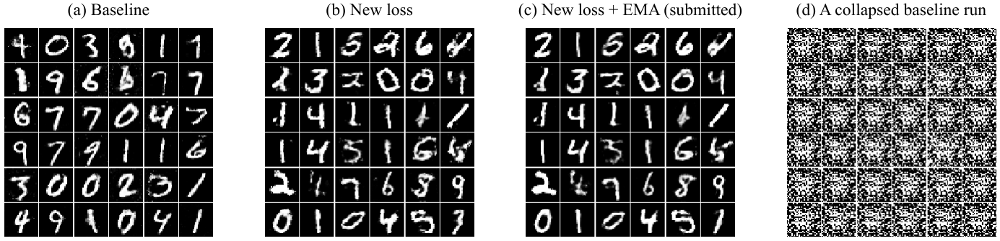

# fixed-generator-gan-mnist — data, training and inference levers for a fixed-architecture GAN

**fixed-generator-gan-mnist** studies how far a small, imposed MNIST GAN generator can be pushed without
touching its architecture, by acting only on the training data, the training procedure and the way images
are drawn at inference. The submitted model reaches an Inception FID of 19.4 on the MNIST test set,
against 38.7 for the provided baseline.



*Samples from the same 36 latent vectors: (a) provided baseline, (b) relativistic loss with R1,
(c) same run with an averaged generator (submitted), (d) a collapsed baseline run.*

## Overview

- **Task**: the generator is a fixed fully connected network (100 → 256 → 512 → 1024 → 784); it must stay
  unchanged, and `python generate.py --batch_size 256` must write exactly 10,000 28×28 images to `samples/`.
- **Levers**: instance selection and instance noise (data), relativistic loss with R1 penalty and weight
  averaging (training), discriminator rejection sampling DRS / OBRS with a recalibrated discriminator (inference).
- **Protocol**: one frozen split (50,000 train / 10,000 validation / 10,000 test), 200 epochs, last checkpoint,
  three seeds per variant, 10,000 generated images scored against the MNIST test set.
- **Context**: DataLab team project (Assignment 2), Master IASD, PSL University, November 2026.
  Runs on the MesoNet Juliet cluster (NVIDIA A100) and on an Apple M3.

## Results

Common protocol, mean ± s.d. over 3 seeds, 10,000 images against the MNIST test set. FID<sub>Inc</sub>:
Inception FID used by the course platform (lower is better). Precision and recall use VGG-16 features (k = 5).

| Configuration | FID<sub>Inc</sub> | Precision | Recall | Images kept |
|---|---:|---:|---:|---:|
| Baseline (provided loss) | 38.7 ± 1.2 | 0.47 | 0.51 | 100% |
| Baseline + DRS | 34.4 ± 0.7 | 0.51 | 0.49 | 30% |
| Baseline + EMA | 30.0 ± 0.2 | 0.56 | 0.54 | 100% |
| RpGAN + R1, raw generator | 37.7 ± 1.0 | 0.47 | 0.47 | 100% |
| RpGAN + R1 + EMA | 22.1 ± 1.3 | 0.59 | 0.59 | 100% |
| RpGAN + R1 + EMA + instance noise | 21.4 ± 0.6 | 0.60 | 0.61 | 100% |
| RpGAN + R1 + EMA + DRS | 22.0 ± 1.1 | 0.59 | 0.58 | 43% |
| RpGAN + R1 + EMA + OBRS, recalibrated D | **19.7 ± 0.8** | 0.62 | 0.59 | 33% |
| **Submitted** (seed 1, OBRS K = 3, recalibrated D) | **19.4** | 0.61 | 0.60 | 33% |

- The loss and weight averaging only pay off together: the EMA gains −15.6 FID with RpGAN + R1 against −6.7
  with the provided loss (p = 0.002).
- DRS helps the baseline but not the final model, whose discriminator barely separates real from generated
  images (AUC 0.57). Refitting its last layer raises the AUC to 0.77 and brings the gain back.
- Neither data lever beats its reference: keeping the 50% most typical images raises FID<sub>Inc</sub> from
  35.4 to 47.8 and drops recall from 0.52 to 0.32.

All numbers come from [`report.pdf`](report.pdf) (Tables 1–4); the CSVs behind them are in
[`report/data/`](report/data/).

## Installation

Tested with Python 3.12 and PyTorch 2.7 (CPU is enough for generation and tests).

```bash
python -m venv .venv && source .venv/bin/activate
pip install -r requirements.txt -r requirements-dev.txt
python -m pytest tests -q
```

## Quick start

The submitted model (`checkpoints/G.pth`, recalibrated `checkpoints/D.pth`, `checkpoints/sampling.yaml`) is
in the repository. Generate the 10,000 images and score them against the MNIST test set:

```bash
python generate.py --batch_size 256                                  # 10,000 PNG in samples/ (about 3 s on CPU)
python evaluate.py --samples samples --metric prof --reference test  # Inception FID, VGG precision / recall
```

MNIST is downloaded to `data/` on first use.

Reproduce the submitted model (one training run of 200 epochs):

```bash
python train.py --config configs/compare_local/rpgan_r1_ema.yaml --seed 1      # writes runs/cmploc_rpgan_r1_ema_s1/
cp runs/cmploc_rpgan_r1_ema_s1/G.pth checkpoints/
python scripts/recalibrate_d.py runs/cmploc_rpgan_r1_ema_s1 checkpoints/D.pth  # refit the last layer of D
python generate.py --batch_size 256
```

| Step | Command | Output |
|---|---|---|
| Train | `python train.py --config configs/baseline.yaml` | `runs/<name>/` |
| Evaluate a run | `python evaluate.py --run runs/<name> --seeds 0 1 2 --metric prof` | `results/results_prof.csv` |
| Sweep a sampling parameter | `python sweep.py --run checkpoints --sampling configs/sampling/obrs.yaml --param K --values 1 2 5 10 --metric prof` | `results/results_prof.csv` |
| Tune hyperparameters | `python tune.py --config configs/baseline.yaml --n-trials 20` | `runs/optuna.db` |

## Repository structure

- `model.py`: imposed generator and discriminator (unchanged).
- `data.py`: frozen train / validation / test split shared by the team.
- `preprocessing.py`: data lever (instance selection, instance noise).
- `train.py`, `utils.py`: training loop, provided loss, RpGAN + R1/R2 loss, EMA.
- `sampling.py`, `keep_training.py`: inference lever (truncation, DRS, OBRS).
- `evaluate.py`: FID, precision / recall, digit histogram; `generate.py`: imposed generation interface.
- `checkpoints/`: submitted model and the MNIST classifier used by the classifier-based FID.
- `configs/`: one YAML per experiment (`compare_local/`: common protocol; `data/`, `sweep/`, `sampling/`).
- `runs/`, `logs/`, `results/`: configs, metrics, sample grids and logs of the runs (weights are not versioned).
- `scripts/`: Slurm launchers for Juliet, D recalibration, FID audits.
- `docs/`: detailed write-ups per lever, in French (`baseline.md`, `data.md`, `training.md`, `inference.md`,
  `design-choices.md`).
- `report/`, `report.pdf`: final report (ACM format, 5 pages + supplementary); `report_v1/`: earlier version.
- `slides/`, `slides.pdf`: presentation.
- `tests/`: unit tests (split, metrics, sampling, data options).

Branches `nico/preprocessing`, `noe/training`, `quentin/baseline`, `quentin/inference` and
`quentin/comparaison` keep the work of each lever as it was developed.

## Method

- **Relativistic loss with R1** (RpGAN + R1, γ = 1): D compares a real and a generated image instead of
  judging each alone; the R1 gradient penalty on real images stabilises training. γ = 0.1 diverges, γ = 10 learns
  more slowly. No RpGAN + R1 run collapsed.
- **EMA of the generator** (decay 0.999), used for evaluation and saved as `G.pth`.
- **Rejection sampling**: DRS keeps a proposal with a probability derived from D's score (80th percentile);
  OBRS keeps the best proposals for a budget of K = 3 proposals per kept image. Recalibration refits D's last
  layer as a logistic regression on 10,000 real validation images against 10,000 generated ones.
- **Data lever**: keep the 95, 90, 75 or 50% most typical training images per digit (Gaussian fit on classifier
  features), or add Gaussian noise (σ<sub>0</sub> = 0.3, annealed to 0) to every input of D.

Full details, ablations and limitations: [`report.pdf`](report.pdf).

## References

1. Y. Huang et al. The GAN is dead; long live the GAN! A modern GAN baseline. NeurIPS, 2024.
2. A. Jolicoeur-Martineau. The relativistic discriminator: a key element missing from standard GAN. ICLR, 2019.
3. L. Mescheder, A. Geiger, S. Nowozin. Which training methods for GANs do actually converge? ICML, 2018.
4. Y. Yazıcı et al. The unusual effectiveness of averaging in GAN training. ICLR, 2019.
5. S. Azadi et al. Discriminator rejection sampling. ICLR, 2019.
6. A. Verine et al. Optimal budgeted rejection sampling for generative models. AISTATS, 2024.
7. T. DeVries, M. Drozdzal, G. W. Taylor. Instance selection for GANs. NeurIPS, 2020.

## Team

Group 3, Master IASD (PSL University): Nicodème Gorge (data lever), Noé Mosca (training lever),
Quentin Revillon (baseline protocol, inference lever). Computations on the MesoNet Juliet cluster.
