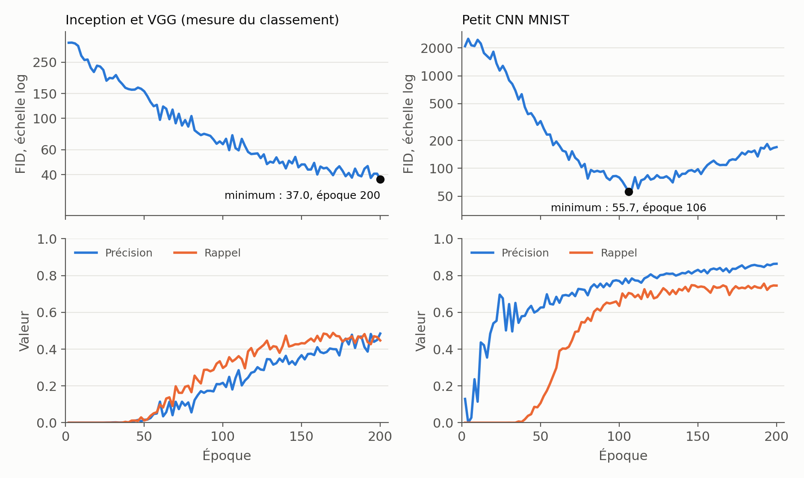
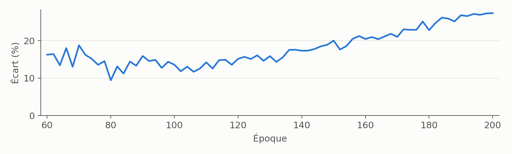
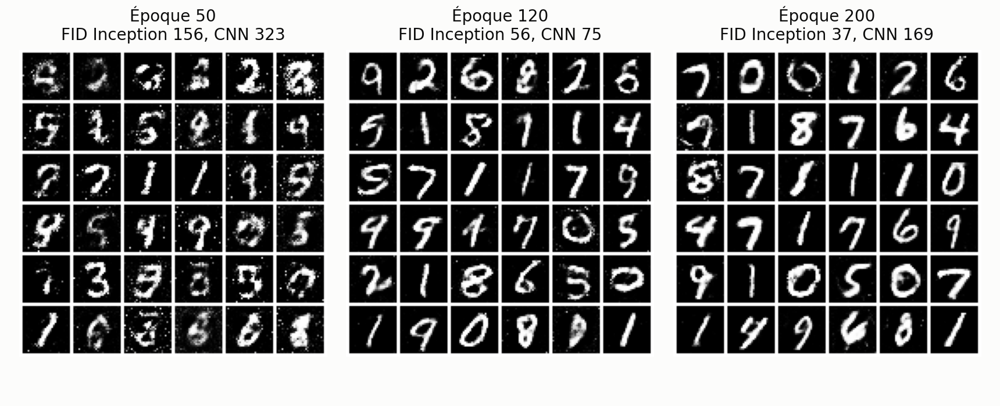
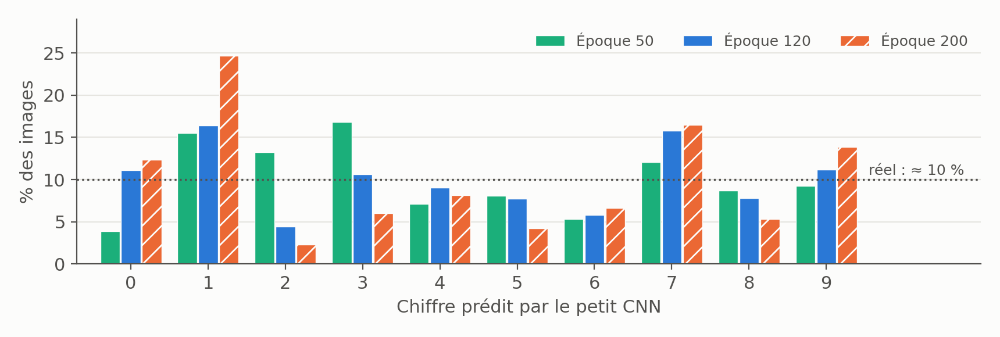

# Baseline : 200 époques, mesurées toutes les 2 époques

> **En une phrase :** avec les réglages du code fourni, le FID Inception descend de **156 à l'époque 50 à 37 à l'époque 200**, et la précision et le rappel progressent aussi. Le prix à payer est un mélange de chiffres de plus en plus déséquilibré, que le petit CNN sanctionne fortement.



*Mêmes poids dans les deux colonnes, seule la mesure change. À gauche, le FID baisse jusqu'à la fin. À droite, il remonte après l'époque 106. La section 3 explique pourquoi.*

**Modèle retenu :** `runs/baseline_200ep_prof/G_best.pth` et `D_best.pth`, soit l'époque 200.

---

## 1. La baseline est-elle correcte ?

**Oui pour le code, avec deux écarts volontaires.** Comparaison avec le premier commit du dépôt, qui contient le code fourni :

| Élément | Code du prof | Notre baseline | Verdict |
|---|---|---|---|
| Architecture de G et de D | `model.py` | fichier inchangé | identique |
| Perte BCE ; un pas de D, puis un pas de G | oui | mêmes calculs | identique |
| Images ramenées dans [−1, 1] | oui | oui | identique |
| Adam, lr 0,0002, betas (0,9 ; 0,999) | oui | oui | identique |
| **Taille de batch** | **64** | **100** | **différent** |
| Nombre d'époques | 100 par défaut, 10 dans le script | 200 | choix mesuré |
| Images d'entraînement | 60 000 | 50 000, les 10 000 autres forment `val` | choix voulu |

- **Le batch de 100** vient de la config commune du groupe, et Noé et Nicodème l'utilisent aussi. On le garde pour pouvoir comparer les volets.
- **Le split :** les 60 000 images de MNIST train sont mélangées une fois, avec la seed 0. `val` sert à faire les choix, et MNIST test reste réservé aux chiffres finaux.
- **La provenance de `checkpoints/G.pth` est inconnue.** Ce fichier a été commité avant les configs YAML (commit `2876b07`), sans trace de ses réglages. Il faudra demander à Nicodème comment il l'a entraîné.

### Reproductibilité : vérifiée

Deux entraînements complets de 200 époques, avec la même config d'entraînement et la même seed :

| | Premier run | Rerun |
|---|---|---|
| Job, nœud | 142505, `juliet3` | 142893, `juliet2` |
| Commit | `a638e4b` | `ca8e2c8` + le changement de `train.py` qui ajoute les mesures |
| Mesures | toutes les 10 époques | toutes les 2 époques, avec Inception et VGG en plus |
| **`G.pth` et `D.pth` finaux** | | **identiques au bit près** |

Mesurer plus souvent ne change donc pas l'entraînement, et le résultat ne dépend pas du nœud A100 utilisé.

## 2. Résultats

| Époque | Mises à jour | FID Inception ↓ | Précision VGG ↑ | Rappel VGG ↑ | FID CNN ↓ | Précision CNN ↑ | Rappel CNN ↑ |
|---|---|---|---|---|---|---|---|
| *Plafond : 10 000 vraies images contre `val`* | | *1,2* | *0,891* | *0,880* | *1,7* | *0,90* | *0,90* |
| 50 | 25 000 | 155,6 | 0,016 | 0,012 | 323,5 | 0,626 | 0,107 |
| 80 | 40 000 | 104,0 | 0,056 | 0,166 | 77,3 | 0,692 | 0,570 |
| 106 | 53 000 | 76,0 | 0,181 | 0,333 | **55,7** | 0,760 | 0,705 |
| 120 | 60 000 | 56,2 | 0,277 | 0,362 | 75,4 | 0,806 | 0,715 |
| 140 | 70 000 | 44,2 | 0,364 | 0,474 | 87,1 | 0,814 | 0,720 |
| 160 | 80 000 | 40,1 | 0,411 | 0,472 | 120,9 | 0,838 | 0,742 |
| 182 | 91 000 | 38,1 | 0,478 | 0,470 | 152,9 | 0,847 | 0,743 |
| **200 (retenue)** | **100 000** | **37,0** | **0,485** | **0,447** | 169,4 | **0,864** | **0,745** |

*Une mesure par époque, avec 10 000 images, contre `val`. Toutes les valeurs sont dans `runs/baseline_200ep_prof/metrics.jsonl`.*

**À l'époque 200, avec 3 seeds de tirage :** FID Inception **36,7 ± 0,2**, précision 0,490 ± 0,004, rappel 0,459 ± 0,008. Sur la même mesure, `checkpoints/G.pth` obtient 43,2 ± 0,4, 0,389 ± 0,007 et 0,429 ± 0,005 : **notre baseline est meilleure sur les trois chiffres**.

**Ce qu'on en retient :**
- **50 époques ne suffisent pas :** à ce stade, les deux FID sont encore en forte baisse et les rappels restent très bas.
- **La courbe Inception baisse encore à l'époque 200.** Un entraînement plus long pourrait l'améliorer encore, mais ce n'a pas été testé.
- **Le FID Inception bouge d'une mesure à l'autre** : 3,2 en moyenne entre deux mesures successives à partir de l'époque 160. L'époque 200 n'est donc pas un optimum précis : la zone 180-200 se vaut à peu près.

## 3. Pourquoi les deux mesures se contredisent

Le petit CNN préfère l'époque 106, Inception l'époque 200. **La cause est le mélange des chiffres.**



*Écart : la part d'images qui devrait changer de chiffre pour atteindre 10 % par chiffre. Après l'époque 100, le déséquilibre augmente presque sans arrêt.*

**Premier indice, la corrélation :** à partir de l'époque 100, ce déséquilibre va de pair avec le FID du CNN (corrélation de +0,97), alors que le FID Inception baisse en même temps (−0,83).

**Le test direct :** on génère 100 000 images, puis on en garde 10 000 avec la même proportion de chaque chiffre que dans `val`. Les images ne changent pas, seul leur mélange change.

| FID du petit CNN | Images telles quelles | Chiffres remis en proportion |
|---|---|---|
| Époque 120 | 75,4 | **30,3** |
| Époque 200 | 169,4 | **32,2** |

**Une fois les proportions corrigées, les deux époques se valent presque, et l'écart de 94 tombe à 2.** La remontée du FID du CNN vient donc surtout du mélange des chiffres, et non d'images moins bonnes. La précision et le rappel du CNN, eux, continuent d'ailleurs à progresser.

*Limite du test : le CNN qui répartit les images par chiffre est aussi celui qui calcule le FID.*

## 4. Les images et les chiffres générés



*Les trois grilles utilisent exactement le même bruit z. À l'époque 50, les images sont bruitées. Aux époques 120 et 200, les chiffres sont nets.*



| Part des images (%) | 0 | 1 | 2 | 3 | 4 | 5 | 6 | 7 | 8 | 9 | Écart |
|---|---|---|---|---|---|---|---|---|---|---|---|
| Époque 50 | 3,9 | 15,5 | 13,2 | 16,8 | 7,1 | 8,1 | 5,4 | 12,0 | 8,7 | 9,2 | 17,6 |
| Époque 120 | 11,1 | 16,4 | 4,4 | 10,7 | 9,1 | 7,8 | 5,8 | 15,8 | 7,8 | 11,2 | 15,2 |
| **Époque 200** | **12,3** | **24,7** | **2,3** | **6,0** | **8,2** | **4,2** | **6,7** | **16,5** | **5,3** | **13,9** | **27,3** |

**C'est le vrai défaut de l'époque 200 :** un quart des images sont des « 1 » et il n'y a que 2,3 % de « 2 ».

## 5. Quelle époque garder ?

| | Pour | Contre |
|---|---|---|
| **Époque 200 (retenue)** | Meilleur FID Inception, la mesure du classement. Précisions les plus hautes avec les deux mesures. | Chiffres très déséquilibrés |
| Époque 106-120 | Meilleur FID du CNN, chiffres plus équilibrés | FID Inception de 56 à 76, précision VGG de 0,18 à 0,28 |

On retient l'époque 200 parce qu'on décide sur la même mesure que le classement. Ce choix reste à confirmer avec le groupe : si l'équilibre des chiffres compte davantage, l'époque 120 reste disponible dans `ckpt/epoch_120.pth` sur Juliet.

## 6. Notre mesure reproduit-elle le classement ?

Le classement indique seulement : FID avec Inception, précision et rappel avec VGG, k = 5, 9 984 images. Pour vérifier notre code, nous avons mesuré le modèle déjà classé, `checkpoints/G.pth` :

| Mesure de `checkpoints/G.pth` | FID | Précision | Rappel |
|---|---|---|---|
| **Classement du prof** | **44,01** | **0,705** | **0,502** |
| Nous, contre test, 3 seeds | 43,0 ± 0,4 | 0,400 ± 0,004 | 0,454 ± 0,006 |
| Nous, contre test, via les PNG de `generate.py` | 42,51 | 0,400 | 0,447 |
| Nous, contre train, 3 seeds | 42,5 ± 0,4 | 0,403 | 0,440 |
| Nous, contre `val`, 3 seeds | 43,2 ± 0,4 | 0,389 ± 0,007 | 0,429 ± 0,005 |

**Notre FID est proche du classement, à environ 1 près. Notre précision ne l'est pas** (0,400 contre 0,705), et notre rappel en est assez proche. La page du classement ne donne ni le prétraitement ni les poids de VGG. Nos précisions et rappels servent donc à comparer nos configurations entre elles, pas à prédire le classement.

## 7. Protocole et commandes

- **Config :** `configs/baseline_200ep_prof.yaml`. Identique à `configs/baseline_200ep.yaml`, sauf pour la fréquence des mesures et des sauvegardes.
- **Durée :** 49 minutes sur un A100, dont environ 14 pour l'entraînement seul (durée du premier run). Une mesure complète coûte environ 20 secondes.
- **Mesures :** 10 000 images contre `val` toutes les 2 époques. `G_best.pth` est choisi sur le FID Inception.

```bash
bash scripts/run.sh "python train.py --config configs/baseline_200ep_prof.yaml" 01:30:00      # sur Juliet
python evaluate.py --run runs/baseline_200ep_prof --weights best --seeds 0 1 2 --metric prof  # 3 seeds
python evaluate.py --sanity --metric prof                                                     # plafond
python figures/make_baseline_figures.py --weights <dossier>                                   # figures et test de la section 3
```

*Le dossier donné aux figures contient `G_ep50.pth`, `G_ep120.pth` et `G_ep200.pth` : ce sont les poids de G de `ckpt/epoch_050.pth`, `ckpt/epoch_120.pth` et `ckpt/epoch_200.pth`, disponibles sur Juliet.*

## 8. Limites et suite

- **Un seul entraînement.** Les ± ne mesurent que le hasard du tirage. Le risque est réel : Nicodème observe un effondrement du GAN sur 3 runs de référence sur 8, avec d'autres seeds et sur 60 000 images (`rapport-donnée.md`, branche `nico/preprocessing`).
- **Pas de chiffre final sur test.** `val` a servi à choisir l'époque : ces chiffres sont légèrement optimistes.
- **Comparaison avec `checkpoints/G.pth` à nuancer :** ce modèle a probablement vu les images de `val` à l'entraînement, et ses réglages sont inconnus.
- **Pas directement comparable à Noé ni à Nicodème :** ils entraînent sur 60 000 images et mesurent avec le petit CNN contre MNIST test.

**Suite :**
1. Répéter avec d'autres seeds.
2. Tester un entraînement plus long, puisque le FID Inception baisse encore à l'époque 200.
3. Mettre le groupe d'accord sur une seule mesure et un seul split, puis donner les chiffres finaux sur test.
