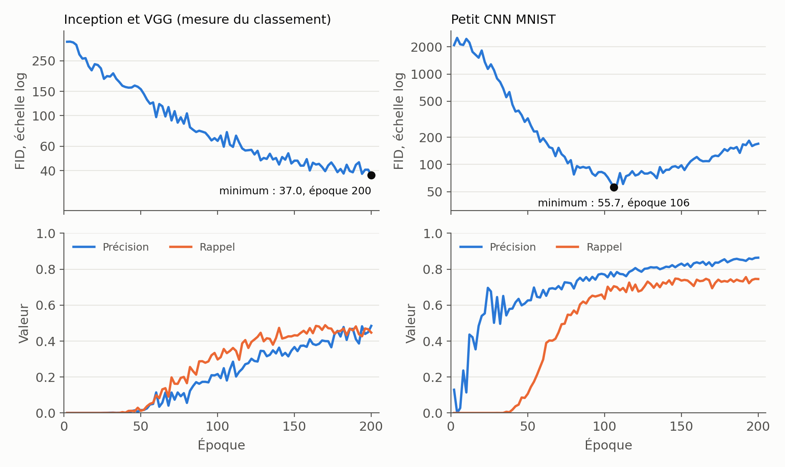
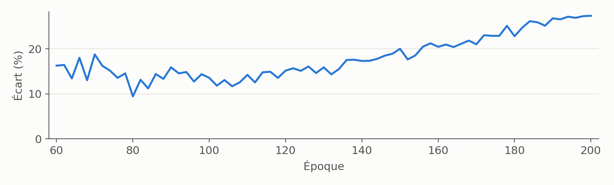
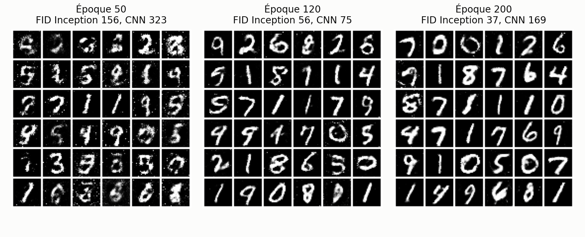
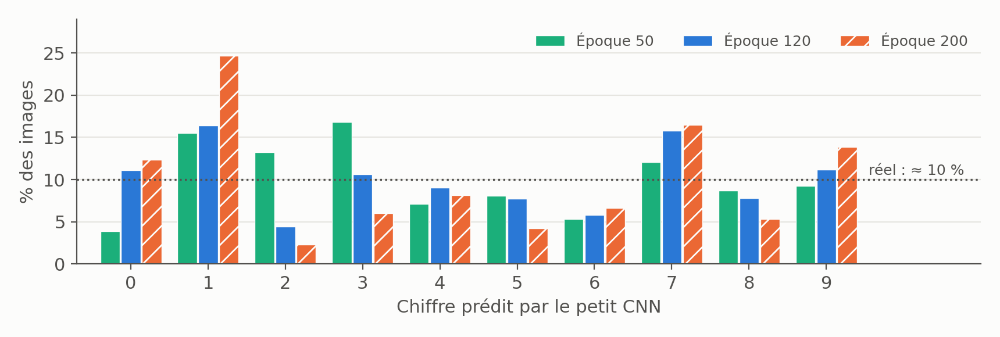

# Baseline : 200 époques avec les réglages du code fourni

> **En une phrase :** en entraînant plus longtemps, le FID Inception descend de **156 à l'époque 50 à 37 à l'époque 200**, et la précision et le rappel progressent aussi. Le prix à payer est un mélange de chiffres de plus en plus déséquilibré.

**Ce qu'il faut retenir :**
- **La baseline est correcte :** le code est conforme à celui du prof, avec un batch de 100 au lieu de 64, à signaler dans le rapport.
- **Elle est reproductible :** deux entraînements complets donnent des poids identiques au bit près.
- **Modèle retenu :** l'époque 200 (`runs/baseline_200ep_prof/G_best.pth` et `D_best.pth`), car on décide sur la même mesure que le classement.
- **Son défaut :** 25 % de « 1 » et seulement 2 % de « 2 ».

*FID, précision et rappel sont définis dans le lexique de `inference.md`, sur la branche `quentin/inference`.*

## 1. Les expériences

| # | Question | Ce qui a été fait | Résultat | Job |
|---|---|---|---|---|
| 1 | Le code respecte-t-il celui du prof ? | Comparaison avec le premier commit du dépôt | Oui, sauf le batch | |
| 2 | 50 époques suffisent-elles ? | `runs/baseline_v1`, 50 époques | Non : le FID du CNN est encore en forte baisse | |
| 3 | Combien d'époques faut-il ? | `runs/baseline_200ep`, 200 époques, petit CNN toutes les 10 époques | Le FID du CNN remonte après l'époque 120 | 142505 |
| 4 | Est-ce reproductible, et que dit la mesure du classement ? | `runs/baseline_200ep_prof`, mêmes réglages, les deux mesures toutes les 2 époques | Mêmes poids. Inception préfère l'époque 200 | 142893 |
| 5 | Pourquoi les deux mesures se contredisent-elles ? | Chiffres remis en proportion, à images inchangées | Le FID du CNN réagit surtout au mélange des chiffres | calcul local |
| 6 | Notre mesure reproduit-elle le classement ? | `checkpoints/G.pth` mesuré et comparé au classement | FID oui, précision non | 142578 |
| 7 | Quel est le meilleur score possible ? | 10 000 vraies images contre `val` | FID 1,2, précision 0,891, rappel 0,880 | 143168 |
| 8 | Le petit CNN est-il fiable ? | Même CNN réentraîné avec 2 autres seeds | Le FID varie de 142 à 224, l'ordre des époques tient | calcul local |

## 2. Les résultats



*Mêmes poids dans les deux colonnes, seule la mesure change. À gauche, le FID baisse jusqu'à la fin. À droite, il remonte après l'époque 106.*

| Époque | Mises à jour | FID Inception ↓ | Précision VGG ↑ | Rappel VGG ↑ | FID CNN ↓ | Précision CNN ↑ | Rappel CNN ↑ |
|---|---|---|---|---|---|---|---|
| *Plafond : 10 000 vraies images contre `val`* | | *1,2* | *0,891* | *0,880* | *1,7* | *0,90* | *0,90* |
| 50 | 25 000 | 155,6 | 0,016 | 0,012 | 323,5 | 0,626 | 0,107 |
| 80 | 40 000 | 104,0 | 0,056 | 0,166 | 77,3 | 0,692 | 0,570 |
| 106 | 53 000 | 76,0 | 0,181 | 0,333 | **55,7** | 0,760 | 0,705 |
| 120 | 60 000 | 56,2 | 0,277 | 0,362 | 75,4 | 0,806 | 0,715 |
| 140 | 70 000 | 44,2 | 0,364 | 0,474 | 87,1 | 0,814 | 0,720 |
| 160 | 80 000 | 40,1 | 0,411 | 0,472 | 120,9 | 0,838 | 0,742 |
| 182 | 91 000 | 38,1 | 0,478 | 0,470 | 152,9 | 0,847 | 0,743 |
| **200 (retenue)** | **100 000** | **37,0** | **0,485** | **0,447** | 169,4 | **0,864** | **0,745** |

*Une mesure par époque, avec 10 000 images, contre `val`. Toutes les valeurs sont dans `runs/baseline_200ep_prof/metrics.jsonl`.*

**Comparaison avec le modèle actuel, sur la même mesure et 3 tirages :**

| | FID Inception ↓ | Précision VGG ↑ | Rappel VGG ↑ |
|---|---|---|---|
| `checkpoints/G.pth` | 43,2 ± 0,4 | 0,389 ± 0,007 | 0,429 ± 0,005 |
| **Époque 200** | **36,7 ± 0,2** | **0,490 ± 0,004** | **0,459 ± 0,008** |

**Trois remarques :**
- **50 époques ne suffisent pas :** les deux FID sont encore en forte baisse et les rappels très bas.
- **La courbe Inception baisse encore à l'époque 200.** Un entraînement plus long pourrait l'améliorer, mais ce n'a pas été testé.
- **L'époque 200 n'est pas un optimum précis :** le FID Inception bouge de 3,2 en moyenne entre deux mesures à partir de l'époque 160. La zone 180-200 se vaut à peu près.

## 3. Pourquoi les deux mesures se contredisent

Le petit CNN préfère l'époque 106, Inception l'époque 200. **La cause est le mélange des chiffres.**



*Écart : la part d'images qui devrait changer de chiffre pour atteindre 10 % par chiffre.*

**Le test :** on génère 100 000 images, puis on en garde 10 000 avec la même proportion de chaque chiffre que dans `val`. Les images ne changent pas, seul leur mélange change.

| FID du petit CNN | Images telles quelles | Chiffres remis en proportion |
|---|---|---|
| Époque 120 | 75,4 | **30,3** |
| Époque 200 | 169,4 | **32,2** |

**Une fois les proportions corrigées, les deux époques se valent presque.** La remontée du FID du CNN vient donc surtout du mélange des chiffres, et non d'images moins bonnes. La précision et le rappel du CNN continuent d'ailleurs à progresser.

À partir de l'époque 100, le déséquilibre va de pair avec le FID du CNN (corrélation de +0,97), alors que le FID Inception baisse en même temps (−0,83).

*Limite du test : le CNN qui répartit les images par chiffre est aussi celui qui calcule le FID.*

### Le petit CNN est-il fiable ?

**Il reconnaît très bien les chiffres, mais son FID ne suffit pas pour choisir un modèle.**

Nicodème l'a entraîné dans le commit `23914a6` : 2 couches de convolution, une couche de 128 valeurs qui sert aux mesures, les 60 000 images de MNIST train, 3 époques, Adam (lr 0,001), batch 128, seed 0.

**Le test :** on réentraîne le même CNN avec deux autres seeds, puis on mesure les mêmes images contre `val`.

| CNN | Précision sur test | FID époque 120 | FID époque 200 | Rappel époque 200 | FID du plafond |
|---|---|---|---|---|---|
| Celui du groupe | 98,71 % | 75,4 | 169,4 | 0,746 | 1,7 |
| Seed 1 | 98,54 % | 96,8 | 224,0 | 0,757 | 2,0 |
| Seed 2 | 98,92 % | 59,4 | 141,7 | 0,741 | 1,4 |

- **La valeur du FID dépend du CNN :** à images identiques, de 142 à 224 à l'époque 200. Elle ne veut donc rien dire seule.
- **L'ordre tient :** l'époque 120 reste environ 2,3 fois meilleure que l'époque 200 avec les trois CNN. On peut comparer deux modèles, à condition d'utiliser le même CNN.
- **La précision et le rappel sont stables :** ils varient d'environ 0,01 à 0,02.
- **Il a vu les images de `val` à l'entraînement :** son plafond est de 1,7 contre `val` et de 3,1 contre test. On ne compare donc jamais un chiffre `val` à un chiffre test.
- **La répartition des chiffres est un indicateur, pas un comptage exact :** il force chaque image à être un chiffre, et 12,6 % des images de l'époque 200 ont une confiance sous 0,9, contre 3,7 % des vraies images.

| Usage | Outil |
|---|---|
| Choisir un modèle | FID Inception |
| Comparer la qualité et la diversité | Précision et rappel VGG, avec le CNN en second avis |
| Voir l'équilibre des chiffres | Répartition donnée par le CNN |
| Citer une valeur de FID seule | Jamais avec le CNN |

## 4. Les images et les chiffres générés



*Les trois grilles utilisent exactement le même bruit. À l'époque 50, les images sont bruitées. Aux époques 120 et 200, les chiffres sont nets.*



| Part des images (%) | 0 | 1 | 2 | 3 | 4 | 5 | 6 | 7 | 8 | 9 | Écart |
|---|---|---|---|---|---|---|---|---|---|---|---|
| Époque 50 | 3,9 | 15,5 | 13,2 | 16,8 | 7,1 | 8,1 | 5,4 | 12,0 | 8,7 | 9,2 | 17,6 |
| Époque 120 | 11,1 | 16,4 | 4,4 | 10,7 | 9,1 | 7,8 | 5,8 | 15,8 | 7,8 | 11,2 | 15,2 |
| **Époque 200** | **12,3** | **24,7** | **2,3** | **6,0** | **8,2** | **4,2** | **6,7** | **16,5** | **5,3** | **13,9** | **27,3** |

## 5. Quelle époque garder ?

| | Pour | Contre |
|---|---|---|
| **Époque 200 (retenue)** | Meilleur FID Inception, la mesure du classement. Précisions les plus hautes avec les deux mesures. | Chiffres très déséquilibrés |
| Époque 106-120 | Meilleur FID du CNN, chiffres plus équilibrés | FID Inception de 56 à 76, précision VGG de 0,18 à 0,28 |

Ce choix reste à confirmer avec le groupe. Si l'équilibre des chiffres compte davantage, l'époque 120 reste disponible dans `ckpt/epoch_120.pth` sur Juliet.

## 6. Limites et suite

**Limites :**
- **Un seul entraînement :** les ± ne mesurent que le hasard du tirage. Le risque est réel : Nicodème observe un effondrement du GAN sur 3 runs de référence sur 8, avec d'autres seeds et sur 60 000 images (`data.md`, branche `nico/preprocessing`).
- **Pas de chiffre final sur test :** `val` a servi à choisir l'époque, donc les chiffres sont légèrement optimistes.
- **Comparaison avec `checkpoints/G.pth` à nuancer :** ce modèle a probablement vu les images de `val` à l'entraînement, et ses réglages sont inconnus. Il faut demander à Nicodème comment il l'a entraîné.
- **Pas directement comparable à Noé ni à Nicodème :** ils entraînent sur 60 000 images et mesurent avec le petit CNN contre MNIST test.

**Suite :**
1. Répéter avec d'autres seeds.
2. Tester un entraînement plus long.
3. Mettre le groupe d'accord sur une seule mesure et un seul split, puis donner les chiffres finaux sur test.

---

# Annexes

## A. Comparaison avec le code du prof (expérience 1)

| Élément | Code du prof | Notre baseline | Verdict |
|---|---|---|---|
| Architecture de G et de D | `model.py` | fichier inchangé | identique |
| Perte BCE ; un pas de D, puis un pas de G | oui | mêmes calculs | identique |
| Images ramenées dans [−1, 1] | oui | oui | identique |
| Adam, lr 0,0002, betas (0,9 ; 0,999) | oui | oui | identique |
| **Taille de batch** | **64** | **100** | **différent** |
| Nombre d'époques | 100 par défaut, 10 dans le script | 200 | choix mesuré |
| Images d'entraînement | 60 000 | 50 000, les 10 000 autres forment `val` | choix voulu |

- **Le batch de 100** vient de la config commune du groupe, et Noé et Nicodème l'utilisent aussi. On le garde pour pouvoir comparer les volets.
- **Le split :** les 60 000 images de MNIST train sont mélangées une fois, avec la seed 0. `val` sert à faire les choix, et MNIST test reste réservé aux chiffres finaux.

## B. Reproductibilité (expériences 3 et 4)

| | Premier run | Rerun |
|---|---|---|
| Job, nœud | 142505, `juliet3` | 142893, `juliet2` |
| Commit | `a638e4b` | `ca8e2c8` + le changement de `train.py` qui ajoute les mesures |
| Mesures | toutes les 10 époques | toutes les 2 époques, avec Inception et VGG en plus |
| **`G.pth` et `D.pth` finaux** | | **identiques au bit près** |

Mesurer plus souvent ne change donc pas l'entraînement, et le résultat ne dépend pas du nœud A100 utilisé.

## C. Notre mesure et le classement (expérience 6)

Le classement indique seulement : FID avec Inception, précision et rappel avec VGG, k = 5, 9 984 images. Mesures de `checkpoints/G.pth` :

| Mesure | FID | Précision | Rappel |
|---|---|---|---|
| **Classement du prof** | **44,01** | **0,705** | **0,502** |
| Nous, contre test, 3 seeds | 43,0 ± 0,4 | 0,400 ± 0,004 | 0,454 ± 0,006 |
| Nous, contre test, via les PNG de `generate.py` | 42,51 | 0,400 | 0,447 |
| Nous, contre train, 3 seeds | 42,5 ± 0,4 | 0,403 | 0,440 |
| Nous, contre `val`, 3 seeds | 43,2 ± 0,4 | 0,389 ± 0,007 | 0,429 ± 0,005 |

**Notre FID est proche du classement, à environ 1 près. Notre précision ne l'est pas**, et notre rappel en est assez proche. La page du classement ne donne ni le prétraitement ni les poids de VGG. Nos précisions et rappels servent donc à comparer nos configurations entre elles, pas à prédire le classement.

## D. Protocole et commandes

- **Config :** `configs/baseline_200ep_prof.yaml`. Identique à `configs/baseline_200ep.yaml`, sauf pour la fréquence des mesures et des sauvegardes.
- **Durée :** 49 minutes sur un A100, dont environ 14 pour l'entraînement seul (durée du premier run). Une mesure complète coûte environ 20 secondes.
- **Mesures :** 10 000 images contre `val` toutes les 2 époques. `G_best.pth` est choisi sur le FID Inception.

```bash
bash scripts/run.sh "python train.py --config configs/baseline_200ep_prof.yaml" 01:30:00      # sur Juliet
python evaluate.py --run runs/baseline_200ep_prof --weights best --seeds 0 1 2 --metric prof  # 3 seeds
python evaluate.py --sanity --metric prof                                                     # plafond
python figures/make_baseline_figures.py --weights <dossier>                                   # figures et test de la section 3
python scripts/audit_cnn.py <dossier>                                                         # test du petit CNN
```

*Le dossier donné aux figures contient `G_ep50.pth`, `G_ep120.pth` et `G_ep200.pth` : ce sont les poids de G de `ckpt/epoch_050.pth`, `ckpt/epoch_120.pth` et `ckpt/epoch_200.pth`, disponibles sur Juliet.*
