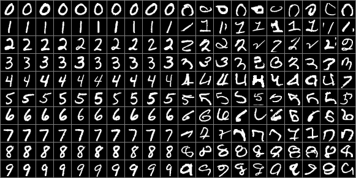
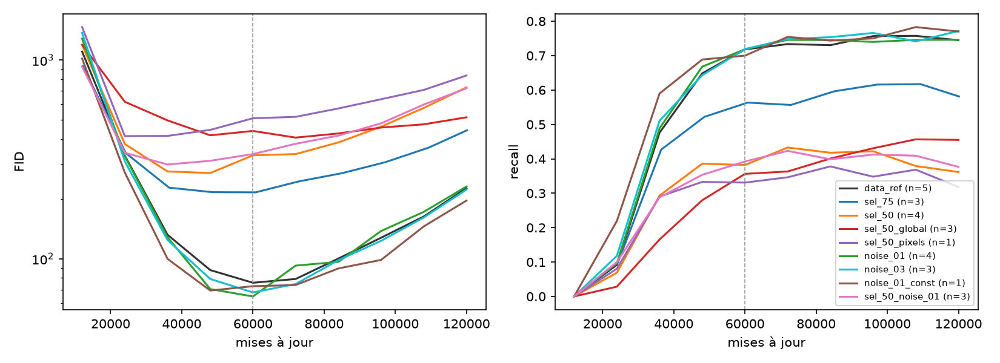
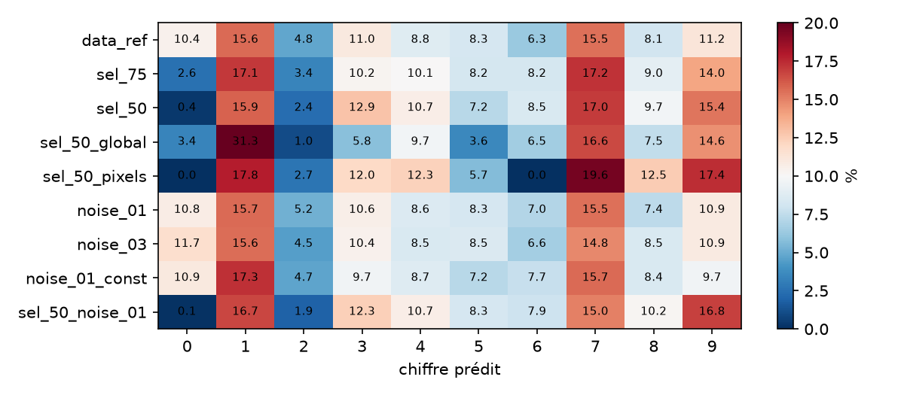

# Volet Données : Instance Selection et Instance Noise

**Responsable :** Nicodème. **Branche :** `nico/preprocessing`. **Code :** [`preprocessing.py`](../preprocessing.py).

**Question (slide 76) :** quelle distribution le modèle apprend-il quand on change ce qu'il voit ?

## En bref

| | Effet mesuré sur nos données | Verdict |
|---|---|---|
| **Instance Selection** (garder 50 % par chiffre) | À 60 000 mises à jour : precision de 0,75 à 0,84, recall de 0,72 à 0,38, FID de 76 à 331 | Le gain de qualité attendu existe, mais le FID se dégrade alors qu'il s'améliore dans le papier à basse résolution |
| **Instance Noise** (σ = 0,1 ou 0,3, décroissant) | FID de 76 à 65-68, écart non significatif (p = 0,10 et 0,23), P et R inchangés | Pas d'effet démontré |
| **Effondrement** du GAN sur 1 à 3 chiffres | 15 runs sur 42, y compris sans aucune option (3 sur 8) | Aucune des deux méthodes ne le corrige sur nos seeds |

Le résultat principal : sélectionner les images égalise le mélange des chiffres **dans les données**, mais pas **dans les images générées**. Le 0 disparaît presque (0,4 %) alors qu'il représente 9,9 % des données d'entraînement. Notre générateur n'est pas conditionnel : rien ne l'oblige à conserver les classes, contrairement aux modèles du papier.

## 1. Ce qui a été implémenté

Les deux options sont indépendantes et se règlent dans la section `data` du YAML. Avec `enabled: false`, ou sans la section, l'entraînement est celui de la baseline.

```yaml
data:
  selection:
    enabled: true
    keep: 0.5             # fraction gardée
    per_class: true       # true : dans chaque chiffre ; false : sur tout le dataset
    space: classifier     # classifier (features) ou pixels (ACP à 50 dim)
  instance_noise:
    enabled: true
    sigma: 0.1            # écart-type initial, images dans [-1, 1]
    anneal_epochs: 100    # décroissance linéaire vers 0 ; 0 = sigma constant
```

**Instance Selection** (DeVries et al., 2020). On ajuste une gaussienne sur les représentations de chaque chiffre, puis on garde les images dont la log-vraisemblance est la plus haute. Le GAN ne voit plus que ce sous-ensemble ; l'évaluation reste faite sur le MNIST test complet.

**Instance Noise** (Sønderby et al., 2017). On ajoute un bruit gaussien aux images réelles et générées avant de les donner à D, avec un écart-type qui décroît linéairement. Le code enveloppe D dans `InstanceNoise`, sans toucher à `model.py` ni à `D_train` / `G_train`. Les images enregistrées et le générateur ne sont pas bruités.

**Pourquoi ces deux méthodes :** elles agissent différemment sur ce que voit le GAN. La sélection retire de la masse aux données. Le bruit élargit les deux distributions pour qu'elles se recouvrent, ce qui est la raison théorique d'Arjovsky & Bottou (2017) ; Mescheder et al. (2018) démontrent sa convergence locale sur le Dirac-GAN, avec σ > 0.

## 2. Protocole

- **Budget commun :** 120 000 mises à jour pour chaque run, soit 200 époques sur 60 000 images, 267 sur 45 000 et 400 sur 30 000.
- **Point de comparaison :** 60 000 mises à jour, le creux du FID de la référence. Ce choix est fait une seule fois pour tous les runs, ce qui évite de prendre le meilleur point de chacun sur le test. Les valeurs finales sont aussi données.
- **Une seule variable à la fois** par rapport à `data_ref`, sauf `sel_50_noise_01` qui vérifie que les options se combinent.
- **Répétitions :** 8 seeds pour `data_ref`, `sel_50` et `noise_01`, 3 seeds pour les autres. Soit 42 runs sur Juliet (GPU, commit `0bf18f5` inscrit dans chaque `config.yaml`).
- **Métriques :** FID, precision et recall k-NN (k = 3) dans les features du classifieur partagé, sur 10 000 images, contre le MNIST test. Un run est dit effondré si son recall final est inférieur à 0,01. Les moyennes ci-dessous excluent ces runs, et leur nombre est indiqué.

## 3. Tests

| Test | Résultat |
|---|---|
| 7 tests unitaires ([`tests/test_preprocessing.py`](../tests/test_preprocessing.py)) : score, taille et mélange des classes, planning de σ, absence de tirage aléatoire à σ = 0 | 7 réussis |
| Options désactivées contre `main` : 2 époques sur CPU, même seed | Poids de G identiques au bit près |
| Essai court de chaque option, avec reprise par `--resume` | Fonctionne |

## 4. Résultats

### Sur les vraies images, sans GAN

Chaque sous-ensemble (10 000 images) est comparé au MNIST test comme s'il avait été généré. C'est **le mieux qu'un GAN parfait pourrait atteindre** en imitant ce sous-ensemble.

| Sous-ensemble | Images | FID | Precision | Recall | FID moyen par chiffre* |
|---|---|---:|---:|---:|---:|
| Tout le train | 60 000 | 2,9 | 0,864 | 0,892 | 9,2 |
| `sel_75` | 44 999 | 9,8 | 0,917 | 0,765 | 30,4 |
| `sel_50` | 30 000 | 25,3 | 0,942 | 0,630 | 67,1 |
| `sel_50_pixels` | 30 000 | 21,8 | 0,933 | 0,640 | 64,7 |
| `sel_50_global` | 30 000 | **180,0** | 0,923 | 0,654 | |

*\*Calculé sur toutes les images du sous-ensemble.*

La sélection globale laisse 1,4 % de 2 et 21,7 % de 1 : c'est pour cela que le papier sélectionne par classe. La figure ci-dessous montre les images les plus denses (à gauche) et les moins denses (à droite) : les rejets ne sont pas des erreurs, mais des écritures rares et valides.



### Sur les GAN

| Variante | Runs effondrés | FID à 60k | Precision à 60k | Recall à 60k | FID final | Precision finale | Recall final |
|---|---:|---:|---:|---:|---:|---:|---:|
| `data_ref` | 3 / 8 | **75,7** ± 10,0 | 0,753 | 0,718 | 226,6 | 0,851 | 0,745 |
| `sel_75` | 0 / 3 | 215,9 ± 39,4 | 0,837 | 0,563 | 443,2 | 0,893 | 0,581 |
| `sel_50` | 4 / 8 | 331,4 ± 13,3 | 0,843 | 0,382 | 729,0 | 0,932 | 0,362 |
| `sel_50_global` | 0 / 3 | 439,8 ± 12,7 | 0,801 | 0,356 | 515,0 | 0,881 | 0,455 |
| `sel_50_pixels` | 2 / 3 | 509,5 (1 run) | 0,882 | 0,331 | 836,2 | 0,931 | 0,318 |
| `noise_01` | 4 / 8 | 64,6 ± 4,6 | 0,764 | 0,718 | 230,9 | 0,853 | 0,746 |
| `noise_03` | 0 / 3 | 67,7 ± 4,8 | 0,763 | 0,719 | 222,9 | 0,848 | 0,772 |
| `noise_01_const` | 2 / 3 | 72,7 (1 run) | 0,799 | 0,700 | 196,2 | 0,841 | 0,770 |
| `sel_50_noise_01` | 0 / 3 | 336,4 ± 20,1 | 0,859 | 0,392 | 721,1 | 0,925 | 0,377 |



**Part de chaque chiffre généré, à 60 000 mises à jour :**



**FID à chiffre fixé** (générateur final, chiffres avec au moins 500 images sur 50 000) :

| Variante | FID moyen par chiffre | Plancher des vraies images | Excès | Chiffres pris en compte |
|---|---:|---:|---:|---:|
| `data_ref` | 71,7 | 9,2 | 63 | 10 |
| `sel_75` | 79,6 | 30,4 | 49 | 8,3 |
| `sel_50` | 130,5 | 67,1 | 63 | 8 |
| `noise_01` | 64,1 | 9,2 | 55 | 9,8 |
| `noise_03` | 55,5 | 9,2 | 46 | 9,3 |

Les chiffres pris en compte diffèrent d'une ligne à l'autre : `sel_50` exclut notamment le 0 et le 2. L'excès se compare donc avec prudence.

## 5. Différences avec les papiers

### Instance Selection

| | Papier | Nous | Conséquence probable |
|---|---|---|---|
| **Générateur** | SAGAN, BigGAN : **conditionnels** | MLP **sans condition** | Le mélange des classes n'est pas imposé : 0 et 2 peuvent disparaître |
| **Données** | ImageNet 64 à 256 px, 1 000 classes, images atypiques nombreuses | MNIST 28 px, 10 classes, déjà centré et propre | Moins de déchets à retirer : on enlève de la diversité utile |
| **Représentation** | Inception pré-entraîné sur ImageNet | Petit CNN entraîné sur MNIST | Même logique ; `sel_50_pixels` teste une représentation indépendante de la métrique |
| **Score** | Gaussienne, légèrement devant PPCA et KNN | Gaussienne, par chiffre | Identique |
| **Rétention** | 10 à 90 %, meilleur FID à 40 % en 64×64 | 75 % et 50 % | Nos deux points ne couvrent pas les taux élevés, proches de 100 % |
| **Capacité** | Réduite, et le papier en fait un argument : moins de données à couvrir | G imposé (slides 74-75), D non modifié | Le gain n'est pas réinvesti dans un modèle mieux adapté |
| **Référence** | Distribution d'entraînement complète | MNIST test complet | Même principe : on mesure contre les données non filtrées |
| **Résultat** | FID de 17,2 à 9,1 (64×64), de 11,5 à 9,6 (128×128), recall de 0,66 à 0,50 | FID de 76 à 331, recall de 0,72 à 0,38 | Recall : même sens. FID : sens opposé |

### Instance Noise

| | Sønderby et al. (2017) | Nous |
|---|---|---|
| **Tâche** | Super-résolution, ImageNet | Génération sans condition, MNIST |
| **Motivation** | Supports disjoints, entraînement instable sans le bruit | Même hypothèse testée |
| **Bruit** | Gaussien, linéairement de 0,1 à 0 | Identique pour `noise_01`, plus σ = 0,3 et σ constant. Leur échelle d'images peut différer |
| **Portée** | Les auteurs ne l'ont pas testé en génération | C'est ce qu'on teste ici |

## 6. Interprétation

**La sélection fait ce qu'elle promet sur la qualité.** La precision monte, sur les vraies images (0,86 à 0,94) comme sur les GAN en fin d'entraînement (0,85 à 0,93). Le coût en recall suit celui des données : à 50 %, même un GAN parfait ne dépasserait pas 0,63.

**Elle dégrade le FID pour deux raisons mesurées.**
1. **Le meilleur score possible se dégrade.** Le FID du sous-ensemble réel passe de 2,9 à 25,3. Par chiffre, il passe de 9,2 à 67,1. Dans l'excès au-dessus de ce plafond, `sel_50` et `data_ref` sont au même niveau (63) : le GAN n'apprend donc pas mieux la distribution réduite, il apprend juste une cible plus étroite.
2. **Le mélange des chiffres se dérègle.** Les données sélectionnées sont équilibrées, mais `sel_50` ne génère que 0,4 % de 0 et 2,4 % de 2. Le FID global y est bien plus sensible qu'à la qualité des traits : en fin d'entraînement, `sel_50` vaut 729 au global, contre 131 par chiffre.

**Pourquoi des chiffres disparaissent (hypothèse).** Les images rejetées sont aussi celles qui font le lien entre les chiffres. Le rapport entre la distance au plus proche autre chiffre et la distance au plus proche même chiffre passe de 3,6 à 5,2 dans les features (de 3,2 à 3,7 en pixels). Un z gaussien continu traverse donc plus difficilement ces écarts. La mesure montre que les classes s'éloignent, mais pas que c'est la cause : il faudrait le tester, par exemple en réinjectant les images frontières.

**Le bruit ne change presque rien.** Le FID à 60k gagne 8 à 11 points, sans signification statistique (Welch, p = 0,10 et 0,23), et l'écart s'annule à la fin. À chiffre fixé, `noise_03` est meilleur que la référence (55,5 contre 71,7 ; p = 0,04), mais ce test n'est pas corrigé pour le nombre de comparaisons faites ici et ne porte que sur 3 runs. Une explication plausible est que MNIST recouvre déjà bien ses supports au niveau de ce que voit un MLP, ou que ces σ sont trop faibles ; nous ne l'avons pas établi.

**L'effondrement n'est pas un problème de données.** Il touche 15 runs sur 42, dont 3 sur 8 sans aucune option. Il se joue au tout début : dans tous ces runs, D(x) reste au-dessus de 0,98 dès la 7e époque au plus tard, et le FID ne bouge plus. `sel_50` (4/8) et `noise_01` (4/8) ne diffèrent pas de `data_ref` (3/8) : le test exact de Fisher donne p = 1. Le 0 sur 3 de `noise_03` et de `sel_75` ne prouve rien : avec un taux de base de 3/8, il arrive une fois sur quatre par hasard. Sur les 3 premières seeds, `sel_50` semblait s'effondrer plus que la référence (2 sur 3 contre 0 sur 3) : cet effet a disparu avec 8 seeds.

**Sur tous les runs, le FID remonte après 60 000 mises à jour** (de 76 à 227 pour la référence) alors que la precision et le recall continuent de monter ou se stabilisent. Le mélange des chiffres dérive : les 2 tombent de 4,8 % à 1,3 %, et ce mélange se rapproche de celui d'une sélection globale à 50 % (corrélation 0,78 à 60k, 0,95 à la fin, sur 10 classes). Le GAN semble donc concentrer sa masse sur les chiffres les plus denses, sans qu'on puisse en conclure la cause. D sur-apprend aussi : en fin d'entraînement, son score moyen vaut 0,68-0,76 sur les images vues et 0,51-0,60 sur le test pour `data_ref` ; sous `sel_50`, les images rejetées (jamais vues) reçoivent le même score que le test. Cette mesure a été faite une seule fois, hors de `make_data_figures.py`. Cela explique l'écart constaté plus tôt : la baseline à 50 époques (30 000 mises à jour) était encore en pleine descente. Ces chiffres finaux dépendent donc fortement du moment de l'arrêt, et le sujet concerne aussi le volet Entraînement.

**Réponse à la question de départ.** En filtrant les images, on change bien la distribution apprise, et dans le sens prévu par le papier pour la precision et le recall. Mais le bénéfice du papier repose sur des hypothèses absentes ici : un modèle conditionnel, des données avec de vrais déchets et une capacité recyclée. Sur MNIST avec un MLP sans condition, la queue de distribution est de la diversité utile.

## 7. Limites

- **Peu de runs utiles :** `sel_50_pixels` et `noise_01_const` n'ont qu'un run non effondré, et les variantes à 3 seeds ne permettent pas de conclure sur l'effondrement.
- **Exclure les runs effondrés** améliore les moyennes de toutes les variantes : c'est une lecture conditionnelle à la réussite de l'entraînement.
- **Métrique et sélection partagent le même classifieur.** C'est un biais signalé pour le papier. `sel_50_pixels` donne un sous-ensemble équivalent sur les vraies images, sans le lever pour l'évaluation.
- **Le MNIST test sert de référence partout** : le split train / val de la branche `quentin/inference` n'est pas sur `main`. Nos runs entraînent sur les 60 000 images, et la valeur de 60 000 mises à jour a été lue sur le test. Avant le rapport final, il faudra refaire les chiffres retenus avec ce split.
- **Le FID n'est pas comparable** à celui de l'évaluation officielle (autre extracteur), ni à celui des runs MPS : avec une même seed, la baseline y donne 161 puis 188 selon le run.
- **Le FID par chiffre** utilise le chiffre prédit par le classifieur et le générateur final, et non celui à 60 000 mises à jour.

## 8. Reproduire

```bash
scripts/data_runs.sh
python figures/make_data_figures.py --real
python figures/make_data_figures.py
python figures/make_data_figures.py --per-class
python -m pytest tests/test_preprocessing.py
```

`scripts/data_runs.sh` lance les seeds 0 à 2 sur Juliet. Les seeds 3 à 7 de `data_ref`, `noise_01` et `sel_50` s'obtiennent avec `python train.py --config configs/data/<variante>.yaml --seed <n>`. Les mesures brutes sont dans [`figures/data/`](../figures/data/).

## Sources

- T. DeVries, M. Drozdzal, T. Taylor, [*Instance Selection for GANs*](https://arxiv.org/abs/2007.15255), NeurIPS 2020.
- C. Sønderby, J. Caballero, L. Theis, W. Shi, F. Huszár, [*Amortised MAP Inference for Image Super-resolution*](https://arxiv.org/abs/1610.04490), ICLR 2017.
- M. Arjovsky, L. Bottou, [*Towards Principled Methods for Training GANs*](https://arxiv.org/abs/1701.04862), ICLR 2017.
- L. Mescheder, A. Geiger, S. Nowozin, [*Which Training Methods for GANs do actually Converge?*](https://proceedings.mlr.press/v80/mescheder18a.html), ICML 2018.
