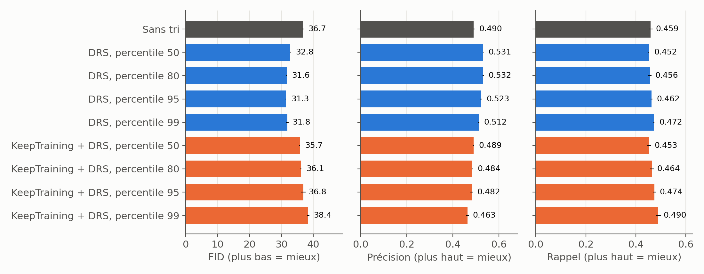
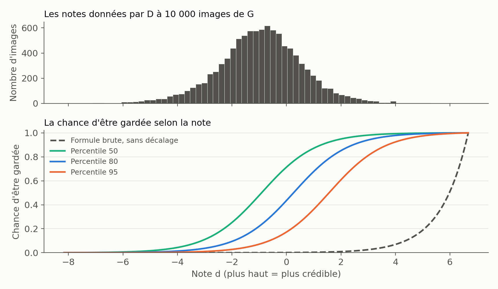
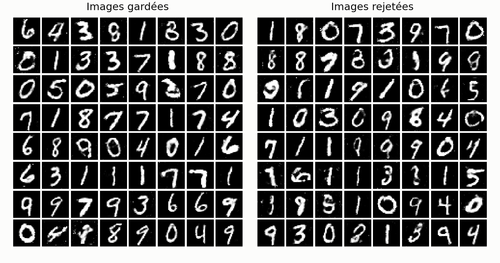
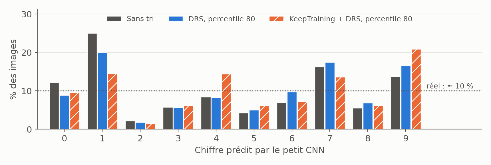
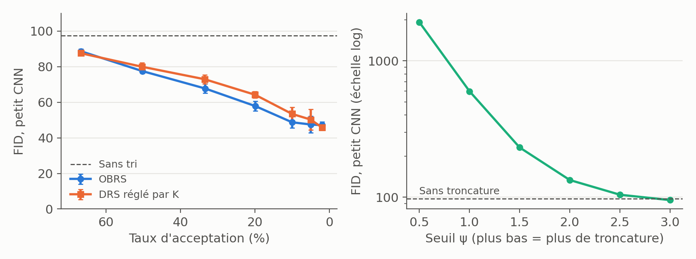

# Volet Inférence : trier les images du générateur

> **En une phrase :** on garde le générateur tel quel et on utilise le discriminateur pour écarter une partie de ses images. Sur la baseline de l'époque 200, le FID passe de **36,7 à 31,6** et la précision de **0,490 à 0,532**, sans perte de rappel (0,459 → 0,456), en proposant environ **3,4 images pour en garder une**.



*Tous les résultats sur le G de l'époque 200, avec Inception et VGG, contre les 10 000 images de `val`. Chaque barre est la moyenne de 3 tirages. Gris : sans tri. Bleu : la méthode DRS. Orange : la méthode DRS après l'étape KeepTraining.*

---

## 1. Le vocabulaire

| Terme | Ce que ça veut dire |
|---|---|
| **G** (générateur) | Le réseau qui fabrique des images de chiffres à partir de bruit. Son architecture est imposée. |
| **D** (discriminateur) | Le réseau qui apprend à distinguer les vraies images de celles de G. Il donne une note à chaque image. |
| **FID** | Distance entre les images générées et les vraies. Plus il est bas, mieux c'est. |
| **Précision** | Part des images générées qui ressemblent à de vraies images. Mesure la qualité. |
| **Rappel** | Part des vraies images dont G produit des équivalents. Mesure la diversité. |
| **Inception et VGG** | Deux grands réseaux pré-entraînés sur ImageNet, utilisés par le classement du prof : Inception pour le FID, VGG pour la précision et le rappel. |
| **Petit CNN** | Un petit réseau entraîné sur MNIST par le groupe. Il donne d'autres valeurs : on ne compare jamais un FID du CNN à un FID Inception. |
| **`val`** | 10 000 vraies images retirées de l'entraînement, qui servent à faire des choix sans toucher au test. |
| **Seed** | Le numéro qui fixe le hasard d'un tirage. |
| **Taux d'acceptation** | Part des images proposées par G que l'on garde. |

## 2. Tout ce qui a été fait

| Étape | Ce qui a été fait | Résultat | Où |
|---|---|---|---|
| 1 | Baseline vérifiée, 200 époques, deux mesures | Époque 200 retenue, FID Inception 36,7 | [`baseline.md`](baseline.md) |
| 2 | Premiers essais : OBRS, DRS réglé par K, troncature | Le tri aide, la troncature n'aide pas | Section 8 |
| 3 | DRS du papier d'Azadi, sur l'époque 120 | FID de 56,3 à 52,2 | Section 7 |
| 4 | DRS du papier d'Azadi, sur l'époque 200 | **FID de 36,7 à 31,6** | Section 5 |
| 5 | Chaîne complète avec `generate.py`, batchs de 256 | FID de 37,1 à 31,7, 10 000 PNG | Section 5.4 |
| 6 | Tests automatiques | 40 tests passent | `tests/` |

## 3. Comment marche le DRS

Le papier : **Azadi, Olsson, Darrell, Goodfellow, Odena.** *Discriminator Rejection Sampling.* ICLR 2019. [arXiv:1810.06758](https://arxiv.org/abs/1810.06758)

### 3.1 L'idée

1. G propose une image.
2. D lui donne une **note** `d` : plus elle est haute, plus l'image lui semble vraie.
3. On transforme cette note en **chance d'être gardée**.
4. On tire au sort : l'image est gardée ou jetée.
5. On recommence jusqu'à avoir 10 000 images.

G n'est jamais modifié. Le tirage au sort laisse une chance aux images moins bien notées, au lieu de ne garder que celles qui ont les meilleures notes.

### 3.2 De la note à la chance d'être gardée



*En haut : les notes de 10 000 images de G. En bas : la chance d'être gardée selon la note. Plus le percentile est haut, plus la courbe se décale vers la droite, donc plus on rejette.*

**La formule brute.** La théorie dit de garder une image avec la chance `exp(d − d_M)`, où `d_M` est la meilleure note observée (ici 6,67). Le problème est visible sur la courbe en pointillés : presque toutes les images ont une chance minuscule. En moyenne, on n'en garderait que **0,21 %**.

**La correction : F̂.** F̂ (« F chapeau ») est un nom pour désigner **la chance brute, placée sur une autre échelle, puis décalée**. Il y a trois étapes :

1. **On change d'échelle :** on convertit la chance brute `a` avec `log(a / (1 − a))`. Sur cette échelle, on peut ajouter ou retirer n'importe quelle valeur sans sortir de l'intervalle de 0 à 100 %.
2. **On décale :** on retire une valeur `γ` (« gamma »). Ce résultat est F̂.
3. **On revient à une chance :** la fonction σ, la sigmoïde, ramène F̂ entre 0 et 100 %.

Écrit en une ligne, c'est l'équation 8 du papier, où `ε` est une toute petite valeur qui évite un calcul impossible :

```
F̂ = d − d_M − log(1 − exp(d − d_M − ε)) − γ        chance d'être gardée = σ(F̂)
```

**Le percentile choisit le décalage.** On calcule ce score avant décalage pour toutes les images d'un batch, et `γ` est la valeur qui dépasse 80 % d'entre elles pour le percentile 80. Une image pile à ce niveau obtient alors F̂ = 0, donc **exactement 50 % de chances**. Le papier utilise le percentile 95 sur son jeu 2D et le 80 sur ImageNet. Ce réglage par percentile est propre au DRS : OBRS, par exemple, se règle autrement (section 8).

**Un exemple avec nos chiffres :**

| Image dont la note dépasse… | Note `d` | Formule brute | Percentile 50 | Percentile 80 | Percentile 95 |
|---|---|---|---|---|---|
| 10 % des images | −2,85 | 0,01 % | 12,6 % | 4,3 % | 1,2 % |
| 50 % des images | −0,91 | 0,05 % | **50,0 %** | 23,6 % | 7,7 % |
| 80 % des images | 0,26 | 0,16 % | 76,4 % | **50,0 %** | 21,3 % |
| 95 % des images | 1,56 | 0,61 % | 92,3 % | 78,7 % | **50,0 %** |

*Valeurs mesurées sur 10 000 images de l'époque 200, avec le D d'origine.*

**Attention :** le percentile n'est pas la part d'images rejetées. Au percentile 80, on en garde 30 % et non 20 %, car les images sous le seuil gardent une chance d'être prises.

### 3.3 KeepTraining

Le papier demande une étape préalable : **figer G et continuer à entraîner D seul**, en s'arrêtant quand il ne progresse plus sur `val`. L'idée est que la formule n'est juste que si D est très bon.

## 4. Dans le code et en pratique

| Élément | Valeur | Origine |
|---|---|---|
| Estimation de `d_M` | 10 000 images, puis mise à jour pendant le tirage | papier |
| `γ` | percentile par batch, testé à 50, 80, 95, 99 | papier pour 80 et 95 ; 50 et 99 ajoutés |
| `ε` | 0,000001 | **notre choix** : le papier dit « a small constant » |
| KeepTraining | G figé, arrêt sur `val` | papier |
| Réglages de KeepTraining | lr 0,0002, mesure tous les 100 pas, arrêt après 5 mesures sans progrès, 20 000 pas au plus | **notre choix** : le papier n'en donne pas |

| Fichier | Rôle |
|---|---|
| [`sampling.py`](sampling.py) | `drs_f_hat` calcule F̂, `sample_drs_azadi` fait la boucle de tirage |
| [`keep_training.py`](keep_training.py) | L'étape KeepTraining |
| [`configs/sampling/drs_azadi.yaml`](configs/sampling/drs_azadi.yaml) | Les paramètres : percentile, `ε`, nombre d'images pour estimer `d_M` |
| [`sweep.py`](sweep.py) | Fait varier le percentile |

```bash
R=runs/baseline_200ep_prof; S=configs/sampling
python keep_training.py --run $R --weights best
python evaluate.py --run $R --weights best --sampling $S/plain.yaml --seeds 0 1 2 --metric prof
python sweep.py --run $R --weights best    --sampling $S/drs_azadi.yaml --param percentile --values 50 80 95 99 --metric prof
python sweep.py --run $R --weights best_kt --sampling $S/drs_azadi.yaml --param percentile --values 50 80 95 99 --metric prof
```

**Protocole :** le même G partout, seul le tri change. Mesure avec Inception et VGG contre `val`, sur 10 000 images, avec 3 seeds (0, 1, 2). Job 143166, 10 minutes sur un A100, commit `ca8e2c8`.

## 5. Résultats sur l'époque 200

| Config | Percentile | Images gardées | FID ↓ | Précision ↑ | Rappel ↑ |
|---|---|---|---|---|---|
| Sans tri | | 100 % | 36,7 ± 0,2 | 0,490 ± 0,004 | 0,459 ± 0,008 |
| DRS | 50 | 50,1 % | 32,8 ± 0,1 | 0,531 ± 0,001 | 0,452 ± 0,002 |
| **DRS (retenu)** | **80** | **29,7 %** | **31,6 ± 0,1** | **0,532 ± 0,003** | **0,456 ± 0,006** |
| DRS | 95 | 13,6 % | 31,3 ± 0,1 | 0,523 ± 0,004 | 0,462 ± 0,004 |
| DRS | 99 | 5,1 % | 31,8 ± 0,4 | 0,512 ± 0,002 | 0,472 ± 0,002 |
| KeepTraining + DRS | 50 | 49,5 % | 35,7 ± 0,2 | 0,489 ± 0,002 | 0,453 ± 0,007 |
| KeepTraining + DRS | 80 | 22,2 % | 36,1 ± 0,2 | 0,484 ± 0,001 | 0,464 ± 0,007 |
| KeepTraining + DRS | 95 | 7,2 % | 36,8 ± 0,7 | 0,482 ± 0,006 | 0,474 ± 0,005 |
| KeepTraining + DRS | 99 | 2,1 % | 38,4 ± 0,4 | 0,463 ± 0,006 | 0,490 ± 0,010 |

*Source : `results/results_prof.csv`. Les ± ne mesurent que le hasard du tirage, avec un seul G entraîné.*

### 5.1 Le gain

- **Le FID passe de 36,7 à 31,6.** Pour comparaison, le papier passe de 18,21 à 17,14 sur SAGAN et de 14,79 à 13,57 sur sa version améliorée, avec d'autres modèles et d'autres données.
- **La précision monte de 0,490 à 0,532, et le rappel ne bouge pas** (0,459 → 0,456, dans les écarts-types).
- **Rejeter davantage n'apporte presque plus rien après le percentile 80 :** le percentile 95 gagne 0,3 de FID, mais perd en précision et garde deux fois moins d'images. On retient donc le 80.



*Mêmes propositions de G, séparées par le DRS au percentile 80. À l'œil, la différence est faible : des images rejetées sont correctes et certaines images gardées sont ratées. Le tri agit sur l'ensemble des images plus qu'il ne se voit image par image.*

### 5.2 Les chiffres générés



| Part des images (%) | 0 | 1 | 2 | 3 | 4 | 5 | 6 | 7 | 8 | 9 | Écart à 10 % |
|---|---|---|---|---|---|---|---|---|---|---|---|
| Sans tri | 12,2 | 25,0 | 2,2 | 5,7 | 8,4 | 4,2 | 6,9 | 16,2 | 5,5 | 13,7 | 27,1 |
| **DRS, percentile 80** | **8,8** | **20,0** | **1,8** | **5,7** | **8,2** | **5,0** | **9,7** | **17,4** | **6,8** | **16,5** | **24,0** |
| KeepTraining + DRS, percentile 80 | 9,6 | 14,5 | 1,4 | 6,2 | 14,4 | 6,1 | 7,2 | 13,5 | 6,2 | 20,8 | 23,3 |

*Chiffres reconnus par le petit CNN, sur les 3 seeds. L'écart est la part d'images qui devrait changer de chiffre pour atteindre 10 % partout.*

**Le DRS ne corrige pas le déséquilibre de la baseline.** Il réduit les « 1 » en trop, mais le « 9 » monte et le « 2 », déjà rare, descend encore à 1,8 %. L'écart reste élevé, de 27,1 à 24,0.

### 5.3 Avec le petit CNN

| Époque 200, petit CNN | Images gardées | FID | Précision | Rappel |
|---|---|---|---|---|
| Sans tri | 100 % | 168,9 ± 1,9 | 0,862 ± 0,002 | 0,741 ± 0,004 |
| DRS, percentile 50 | 50,1 % | 164,7 ± 5,6 | 0,887 ± 0,002 | 0,739 ± 0,005 |
| **DRS, percentile 80** | **29,7 %** | **145,7 ± 7,7** | **0,890 ± 0,001** | **0,737 ± 0,005** |
| DRS, percentile 95 | 13,6 % | 121,1 ± 2,6 | 0,890 ± 0,001 | 0,739 ± 0,006 |
| DRS, percentile 99 | 5,1 % | 104,1 ± 2,0 | 0,889 ± 0,002 | 0,739 ± 0,004 |

Cette mesure mène à la même conclusion sur la précision (elle monte) et le rappel (il ne bouge pas). Son FID, lui, continue de baisser avec le rejet, et le plateau du percentile 80 n'y apparaît pas. Ce FID étant très sensible au mélange des chiffres ([`baseline.md`](baseline.md), section 3), ce plateau dépend donc de la mesure choisie.

### 5.4 La chaîne réelle : `generate.py`, batchs de 256, PNG

Les résultats ci-dessus utilisent des batchs de 10 000 images, alors que la plateforme lance `python generate.py --batch_size 256`. Nous avons donc mesuré la chaîne complète (1 tirage, seed 0, job 143174) :

| `generate.py --batch_size 256`, puis `evaluate.py --samples` | Images | Acceptation | FID | Précision | Rappel |
|---|---|---|---|---|---|
| Sans tri | 10 000 PNG | 100 % | 37,1 | 0,479 | 0,449 |
| **DRS, percentile 80** | **10 000 PNG** | **29,6 %** | **31,7** | **0,529** | **0,473** |

**Le résultat tient dans les conditions réelles.**

## 6. Ce qui échoue : KeepTraining

**Avec KeepTraining, le FID est moins bon à tous les percentiles, sur les deux époques testées**, alors que cette étape fait partie de la méthode du papier.

| | Perte de D sur `val` | Arrêt | FID au percentile 80, D d'origine | FID au percentile 80, KeepTraining |
|---|---|---|---|---|
| Époque 200 | 1,162 → 0,222 | pas 2 600 | **31,6** | 36,1 |
| Époque 120 | 1,066 → 0,048 | pas 4 000 | **52,2** | 53,5 |

- **D sépare beaucoup mieux les images**, et il rejette donc davantage : au percentile 80, on garde 22 % des images au lieu de 30 %.
- **Le rappel monte pourtant**, jusqu'à 0,490 au percentile 99. Nous n'avons pas d'explication vérifiée.
- **Le déséquilibre des chiffres n'explique pas tout :** il s'aggrave à l'époque 120 (écart de 21,6 contre 11,5), mais pas à l'époque 200 (23,3 contre 24,0), alors que le FID est moins bon dans les deux cas.

**Conclusion :** on n'utilise pas KeepTraining ici. Cette conclusion repose sur un seul G entraîné et sur nos propres réglages d'arrêt, que le papier ne fixe pas.

## 7. Le même DRS sur l'époque 120

Ce run avait été fait avant que le rerun montre que l'époque 200 est meilleure avec Inception. Il reste utile : il montre que le gain dépend du modèle.

| Config | Percentile | Images gardées | FID ↓ | Précision ↑ | Rappel ↑ |
|---|---|---|---|---|---|
| Sans tri | | 100 % | 56,3 ± 0,2 | 0,275 ± 0,004 | 0,363 ± 0,005 |
| DRS | 50 | 50,4 % | 53,0 ± 0,2 | 0,294 ± 0,002 | 0,365 ± 0,012 |
| DRS | 80 | 32,1 % | 52,2 ± 0,3 | 0,303 ± 0,001 | 0,352 ± 0,002 |
| DRS | 95 | 16,4 % | 52,1 ± 0,2 | 0,304 ± 0,003 | 0,351 ± 0,011 |
| DRS | 99 | 7,1 % | 52,1 ± 0,5 | 0,305 ± 0,005 | 0,358 ± 0,008 |
| KeepTraining + DRS | 50 | 49,8 % | 54,5 ± 0,1 | 0,296 ± 0,002 | 0,366 ± 0,003 |
| KeepTraining + DRS | 80 | 21,1 % | 53,5 ± 0,3 | 0,305 ± 0,004 | 0,384 ± 0,006 |
| KeepTraining + DRS | 95 | 6,2 % | 54,1 ± 0,1 | 0,298 ± 0,007 | 0,389 ± 0,008 |
| KeepTraining + DRS | 99 | 1,5 % | 55,6 ± 0,1 | 0,277 ± 0,005 | 0,398 ± 0,013 |

*Job 142710, 13 minutes, commit `ca8e2c8`, run `runs/baseline_200ep`.*

**Le tri ne remplace pas le choix du modèle :** même trié, le G de l'époque 120 (52,2) reste loin derrière le G de l'époque 200 sans aucun tri (36,7). **Les deux gains s'ajoutent :** 200 époques au lieu de 120, puis le DRS, donnent 31,6.

## 8. Les méthodes comparées

**Pourquoi le rejet.** La consigne (slide 82) demande de garder le générateur entraîné, et de rapporter le taux d'acceptation et le temps de génération. Les méthodes de rejet sont les plus simples à brancher : elles n'exigent aucun nouvel entraînement.

| Méthode | Principe | Besoins | Statut |
|---|---|---|---|
| **DRS** (Azadi 2019) | rejet avec un décalage réglé par percentile | D | **implémenté comme dans le papier** |
| **OBRS** (Verine 2024) | rejet optimal pour un budget K fixé : `min(1, exp(d − τ_K))` | D | implémenté, mesuré au petit CNN |
| **DRS réglé par K** | formule de la slide Def. 3.1, avec γ calculé pour un budget K | D | implémenté, mesuré au petit CNN |
| **Troncature** (Brock 2019) | ne tirer que du bruit proche du centre | rien | implémentée, mesurée au petit CNN |
| DGflow, DDLS (Ansari 2021, Che 2020) | déplacer le bruit selon le gradient de D | gradients de D et G | lus, non implémentés |
| MH-GAN (Turner 2019) | chaîne de Metropolis-Hastings sur les notes de D | D recalibré | lu, non implémenté |
| Latent reweighting (Issenhuth 2021) | réseau appris pour repondérer le bruit | un entraînement en plus | lu, non implémenté |
| DOT (Tanaka 2019) | transport optimal dans l'espace du bruit, guidé par D | gradients de D et G | lu, non implémenté |

**Premiers essais, sur `checkpoints/G.pth`.** Ils utilisent le **petit CNN** : leurs FID ne se comparent pas à ceux des sections précédentes. Ils n'ont pas été refaits sur l'époque 200.



| K (propositions par image gardée) | Acceptation | FID, OBRS | FID, DRS réglé par K |
|---|---|---|---|
| 1,5 | 67 % | 88,7 ± 1,3 | 87,6 ± 1,0 |
| 2 | 50 % | 77,5 ± 1,2 | 80,0 ± 2,3 |
| 3 | 33 % | 67,8 ± 2,6 | 73,0 ± 2,5 |
| 5 | 20 % | 57,8 ± 2,7 | 64,2 ± 1,8 |
| 10 | 10 % | 48,8 ± 3,2 | 53,5 ± 3,8 |
| 20 | 5 % | 47,5 ± 4,7 | 50,3 ± 5,9 |
| 50 | 2 % | 47,1 ± 1,8 | 45,8 ± 1,6 |

| Troncature, seuil ψ | 0,5 | 1 | 1,5 | 2 | 2,5 | 3 |
|---|---|---|---|---|---|---|
| FID | 1916,8 | 598,1 | 231,6 | 133,8 | 104,4 | 95,3 |
| Rappel | 0,051 | 0,349 | 0,598 | 0,697 | 0,731 | 0,743 |

*Sans tri ni troncature : FID 97,6 ± 3,6, précision 0,834, rappel 0,744. Moyennes de 3 seeds, contre `val`, `results/results.csv`.*

- **Le tri fait baisser ce FID sans coûter de rappel :** la précision monte d'environ 0,834 à 0,853 et le rappel reste autour de 0,745.
- **OBRS bat le DRS réglé par K à coût égal entre K = 2 et K = 20**, dans les 15 comparaisons par seed. Les deux sont à égalité à K = 1,5, et le DRS réglé par K passe légèrement devant à K = 50.
- **La troncature échoue sur ce G :** sauf à ψ = 3, où elle ne change presque rien, elle dégrade le FID et le rappel.
- **OBRS n'a pas encore été mesuré avec Inception.** Nous ne savons donc pas s'il ferait mieux que le DRS du papier sur l'époque 200.

## 9. Le coût

| Pour 10 000 images | Sans tri | DRS, percentile 80 |
|---|---|---|
| Images à proposer | 10 000 | environ 34 000, plus 10 000 pour estimer `d_M` |
| Temps sur A100, batch de 10 000 | 0,04 s | 0,11 s |
| Temps sur A100, batch de 256 (`generate.py`, sans l'écriture des PNG) | 0,7 s | 1,2 s |
| Temps sur CPU, 4 threads, batch de 256, machine locale | 0,15 s | 1,6 s |

C'est négligeable face à la limite de 1 200 s de la plateforme. Le vrai changement est qu'il faut **livrer D en plus de G**.

## 10. Limites et suite

- **Un seul G entraîné.** Les ± ne couvrent pas la variabilité de l'entraînement.
- **Rien sur test.** L'époque et le percentile sont choisis sur `val` : les chiffres sont légèrement optimistes.
- **Précision et rappel à comparer entre nos configurations seulement :** ils ne reproduisent pas ceux du classement ([`baseline.md`](baseline.md), section 6).
- **Le déséquilibre des chiffres reste entier.** Le DRS améliore le FID Inception sans le corriger.

**Recommandation :** époque 200 + DRS au percentile 80, sans KeepTraining. C'est le meilleur compromis mesuré, avec un FID de 31,7 dans les conditions réelles, contre 43,2 pour `checkpoints/G.pth` sur `val`.

**Suite :**
1. Faire valider ce choix par le groupe, puis l'activer : copier `runs/baseline_200ep_prof/G_best.pth` et `D_best.pth` dans `checkpoints/G.pth` et `D.pth`, puis copier `configs/sampling/drs_azadi.yaml` dans `checkpoints/sampling.yaml`. Ce n'est pas fait : `checkpoints/` contient encore l'ancien modèle et la méthode `plain`.
2. Mesurer OBRS avec Inception sur l'époque 200.
3. Tester le DRS sur les meilleurs modèles de Noé et de Nicodème.
4. Répéter sur plusieurs entraînements, puis donner les chiffres finaux sur test.

---

*Figures : `python figures/make_inference_figures.py`. Le script lit `results/`, les `keep_training.jsonl` et les poids de `runs/baseline_200ep_prof/`.*
