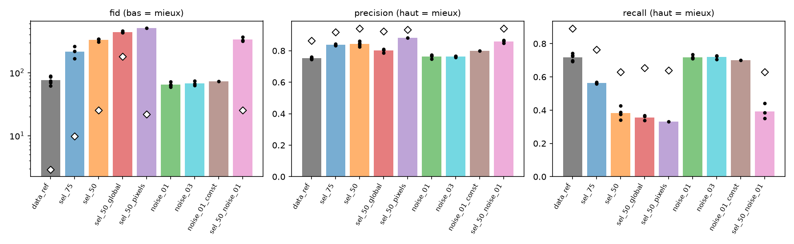
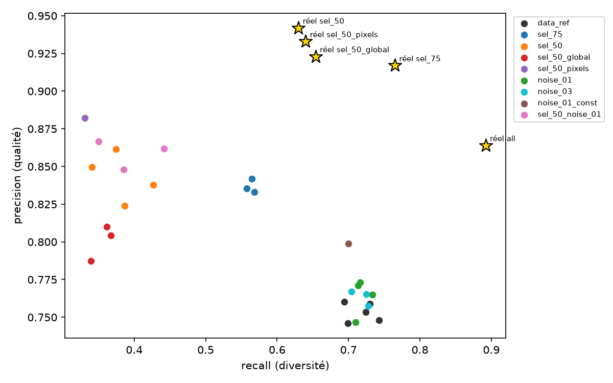
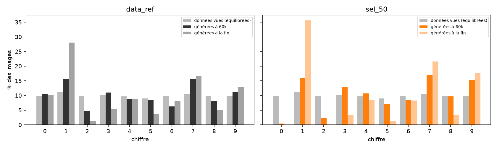
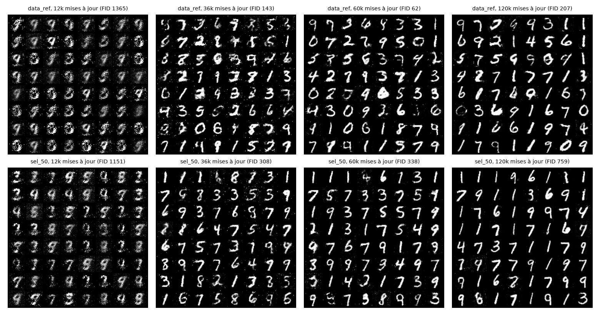
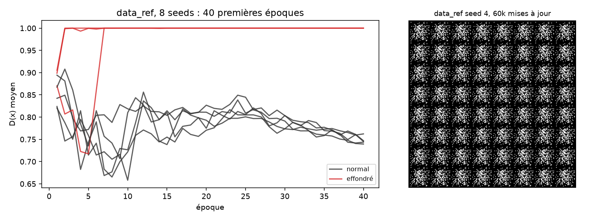

# Volet Données, version illustrée

**Responsable :** Nicodème. **Branche :** `nico/preprocessing`. **Rapport détaillé** (protocole, tests, différences avec les papiers) : [`rapport-donnée.md`](rapport-donnée.md). Ce document-ci part des figures et des exemples.

**Question (slide 76) :** si on change ce que voit le GAN, est-ce que la distribution qu'il apprend change, et en mieux ?

## Ce qu'il faut retenir

1. **Instance Selection** (ne garder que les images les plus typiques) **dégrade le modèle sur MNIST.** Les images sont plus propres, mais moins variées. Certains chiffres disparaissent même : le 0 tombe à 0,4 % des images générées. Le FID passe de 76 à 331. **À ne pas garder.**
2. **Instance Noise** (bruiter les entrées de D) **ne change rien de mesurable.** Le FID passe de 76 à 65, un écart du même ordre que celui qu'on obtient en changeant de seed. Il n'empêche pas les échecs d'entraînement. **Facultatif, sans effet démontré.**
3. **Le vrai problème est ailleurs, côté entraînement :** 15 runs sur 42 échouent dès les premières époques, avec ou sans option. Le FID remonte aussi après 60 000 mises à jour. Ces deux points concernent le volet Entraînement.

Toutes les comparaisons sont faites à **60 000 mises à jour** (c'est-à-dire 60 000 pas d'optimisation), un point fixé à l'avance pour tous les runs. Les moyennes excluent les runs ratés (§ 5).

## 1. Ce que fait la sélection

On ajuste une gaussienne sur les features de chaque chiffre. Les images les plus « denses », c'est-à-dire les plus proches du centre, sont gardées. Le GAN ne s'entraîne que sur elles.


*Pour chaque chiffre : à gauche, les 10 images les plus typiques ; à droite, les 10 moins typiques.*

**Lecture :**
- **À gauche**, les images sont presque identiques : trait régulier, droit, centré.
- **À droite**, on trouve des styles réels mais minoritaires : 7 barré, 4 fermé, 1 avec empattement, 2 bouclé, traits épais ou très penchés.
- **Sur MNIST, les images rejetées sont donc surtout de la diversité, pas des erreurs.** C'est la différence de fond avec ImageNet, où le papier retire des photos ratées ou hors sujet.

## 2. Les scores



*Barre : moyenne des runs réussis. Points : chaque run. Losange blanc : le même score calculé sur les vraies images que voit la variante, c'est-à-dire ce qu'un GAN parfait obtiendrait.*

| Variante | FID ↓ | Precision ↑ | Recall ↑ | Runs ratés |
|---|---:|---:|---:|---:|
| `data_ref` (aucune option) | **75,7 ± 10,0** | 0,753 | **0,718** | 3 / 8 |
| `sel_75` (garde 75 %) | 215,9 ± 39,4 | 0,837 | 0,563 | 0 / 3 |
| `sel_50` (garde 50 %) | 331,4 ± 13,3 | 0,843 | 0,382 | 4 / 8 |
| `sel_50_global` (50 %, sans séparer les chiffres) | 439,8 ± 12,7 | 0,801 | 0,356 | 0 / 3 |
| `noise_01` (σ = 0,1 → 0) | **64,6 ± 4,6** | 0,764 | **0,718** | 4 / 8 |
| `noise_03` (σ = 0,3 → 0) | 67,7 ± 4,8 | 0,763 | 0,719 | 0 / 3 |
| `sel_50_noise_01` (les deux) | 336,4 ± 20,1 | **0,859** | 0,392 | 0 / 3 |

**Lecture :**
- **La sélection fait monter la precision** (0,75 → 0,84) et **chuter le recall** (0,72 → 0,38). Plus on sélectionne, plus l'effet est fort.
- **Le losange limite ce que le GAN peut atteindre.** Avec 50 % des images, même un GAN parfait aurait un recall de 0,63 et un FID de 25 : on s'est fixé un plafond plus bas avant même d'entraîner.
- **Le bruit ne déplace aucune barre** au-delà de l'écart entre seeds (Welch : p = 0,10 pour σ = 0,1, p = 0,23 pour σ = 0,3).
- **Combiner les deux** donne le comportement de la sélection seule : le bruit n'y ajoute rien.



*Chaque point est un run à 60 000 mises à jour. Les étoiles sont les vraies images sélectionnées.*

**Lecture :**
- **Deux nuages bien séparés.** En bas à droite, la référence et les variantes bruitées : diversité élevée, qualité moyenne. En haut à gauche, les variantes sélectionnées : qualité plus haute, diversité divisée par deux.
- **Le bruit ne crée pas de troisième nuage** : ses points se mélangent à ceux de la référence.
- **Aucun GAN n'atteint son étoile.** L'écart restant vient du modèle, pas des données.

## 3. Ce que ça donne en images


*Même vecteur z pour les 6 grilles : une même case correspond au même tirage aléatoire. Premier run réussi de chaque variante.*

**Lecture :**
- **`data_ref`** : les 10 chiffres sont présents, avec des styles variés. On voit quelques artefacts, comme une tache en ligne 5.
- **`sel_75` et `sel_50`** : les traits sont plus nets et plus réguliers, mais les grilles sont dominées par des 1, des 7 et des 9. Le 0 est absent de la grille `sel_50`. C'est exactement « precision ↑, recall ↓ ».
- **`sel_50_global`** : en plus, les chiffres rares dans le sous-ensemble (2, 5) se raréfient encore.
- **`noise_01` et `noise_03`** : visuellement indiscernables de la référence.



*Gris : les données d'entraînement, équilibrées dans les deux cas. Couleur : les images générées, à 60k et en fin d'entraînement.*

**Lecture :**
- **La sélection est faite chiffre par chiffre.** Les données vues par `sel_50` restent donc équilibrées, à 10 % par chiffre.
- **Le GAN ne reproduit pourtant pas cet équilibre :** il génère 0,4 % de 0, 2,4 % de 2, et 16 à 17 % de 1, de 7 et de 9.
- **La raison :** notre générateur n'est pas conditionnel, et rien ne l'oblige à couvrir chaque chiffre. Dans le papier, le modèle reçoit la classe en entrée, et ce problème n'existe pas.
- **Hypothèse :** en retirant les images « frontières » entre chiffres, la sélection éloigne les chiffres les uns des autres. Mesuré dans les features, le rapport entre la distance à l'autre chiffre le plus proche et la distance au même chiffre passe de 3,6 à 5,2. Un générateur qui part d'un z continu a plus de mal à atteindre des modes isolés. Cette mesure montre l'écart, pas qu'il est la cause.

## 4. Au fil de l'entraînement


*Moyenne ± écart-type des runs réussis. Pointillé : 60 000 mises à jour.*



**Lecture :**
- **Toutes les courbes sont en U.** Le meilleur FID se situe vers 48 000-72 000 mises à jour pour la référence, et vers 36 000-48 000 pour la sélection, qui atteint son optimum plus tôt.
- **À droite des courbes, les images ne se dégradent pas, elles se spécialisent.** À 120 000 mises à jour, les chiffres de `data_ref` sont aussi nets qu'à 60 000, et la precision passe même de 0,75 à 0,85. Mais les 1 envahissent la grille : ils passent de 16 % à 28 % des images, et les 2 tombent à 1,3 %. Le FID, sensible au mélange des chiffres, remonte de 76 à 227.
- **Le bruit ne retarde pas cette dérive** : à droite, les quatre courbes restent superposées jusqu'au bout.
- **Conséquence pratique** pour le volet Entraînement : il faut arrêter l'entraînement vers 60 000 mises à jour, ou garder le checkpoint au meilleur FID sur une validation. 200 époques font pire que 100.

## 5. Les runs ratés



*À gauche : score moyen que D donne aux vraies images, pour les 8 seeds de `data_ref`. À droite : ce que produit un run raté.*

**Lecture :**
- **Ce n'est pas un mode collapse sur un chiffre.** Le générateur sort la même tache de bruit pour tous les z. Les 15 runs ratés ont tous cet aspect, et le classifieur les range ensuite le plus souvent dans « 8 » (11 runs sur 15). Le rapport détaillé parle d'effondrement « sur 1 à 3 chiffres » : c'est la lecture du classifieur, pas de l'image.
- **Tout se joue au tout début.** D reconnaît les vraies images avec certitude (D(x) = 1) dès l'époque 2 à 7, et G ne reçoit plus de gradient utile. Les runs sains, eux, oscillent entre 0,7 et 0,85.
- **Ni la sélection ni le bruit n'y changent quoi que ce soit :** 3 runs ratés sur 8 pour la référence, 4 sur 8 pour `sel_50` et pour `noise_01` (test exact de Fisher, p = 1). On aurait pu attendre mieux du bruit, qui est censé rendre la tâche de D plus difficile. Il est sans doute trop faible (σ = 0,1 pour des pixels dans [−1, 1]) pour empêcher D de gagner dès l'époque 2 ; nous ne l'avons pas vérifié avec un σ plus grand au départ.
- **Conséquence pratique :** ce problème se règle côté entraînement. On peut surveiller D(x) et relancer le run s'il dépasse 0,98 avant l'époque 10, ou changer de perte, ce que teste le volet Entraînement.

## 6. Ce que D a appris


*D final de `sel_50` seed 0, 10 000 images de chaque groupe.*

**Lecture :**
- **D reconnaît les images qu'il a vues :** score moyen de 0,78, contre 0,58 sur le MNIST test.
- **Les images rejetées par la sélection, qu'il n'a jamais vues, reçoivent le même score que le test** (0,59). D a donc mémorisé ses images, il n'a pas appris un critère de « typicité ».
- **Il rejette pourtant plus souvent les images atypiques :** près de 1 000 images rejetées tombent dans la tranche D(x) < 0,02, contre 600 pour le test.
- **La référence montre le même écart** (0,68-0,76 sur les images vues, 0,51-0,60 sur le test, mesure ponctuelle hors script). Ce sur-apprentissage de D est une explication plausible de la dérive du § 4 : G est poussé vers ce que D a mémorisé.

## 7. Recommandations pour le modèle final

| Option | Recommandation | Raison |
|---|---|---|
| Instance Selection | **Désactivée** | FID ×4, recall ÷2, chiffres manquants |
| Instance Noise | Désactivé, ou σ = 0,1 si l'on veut | Pas d'effet mesurable, pas de coût |
| Durée d'entraînement | ≈ 60 000 mises à jour, ou meilleur checkpoint sur validation | Le FID remonte ensuite |
| Runs ratés | Détecter D(x) > 0,98 tôt et relancer | 1 run sur 3 échoue, toutes options confondues |

**Ce qui pourrait faire marcher la sélection, non testé :**
- **une rétention élevée** (90-95 %), pour ne retirer que les vraies anomalies ;
- **un générateur conditionnel**, mais l'architecture est imposée ;
- **une sélection par chiffre suivie d'un rééquilibrage** du mélange généré.

## Limites

- **Peu de seeds** pour certaines variantes : 3, et un seul run réussi pour `sel_50_pixels` et `noise_01_const`.
- **Le MNIST test sert de référence partout**, y compris pour choisir le point des 60 000 mises à jour. Il faudra refaire les chiffres retenus avec le split train / val de la branche de Quentin.
- **Le FID utilise notre classifieur MNIST**, et non Inception : il n'est pas comparable à celui de l'évaluation officielle.
- **Les exemples d'images** viennent d'une seule seed par variante. Les tableaux, eux, portent sur tous les runs réussis.

## Reproduire

```bash
python figures/make_data_figures.py --real
python figures/make_data_figures.py
python figures/make_report_figures.py
```

Les runs sont dans `runs/` : il faut les fichiers TensorBoard, ainsi que `D.pth` pour la figure du § 6. Les figures de ce rapport sont dans [`figures/report/`](figures/report/).
