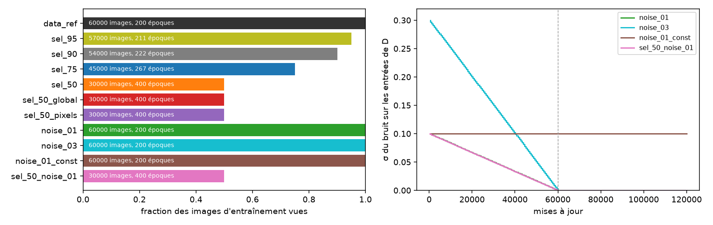
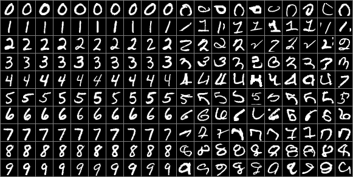
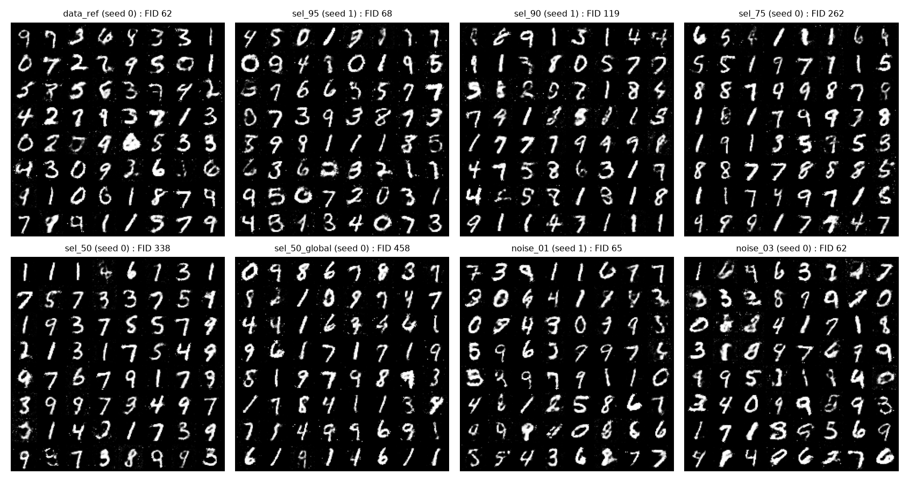
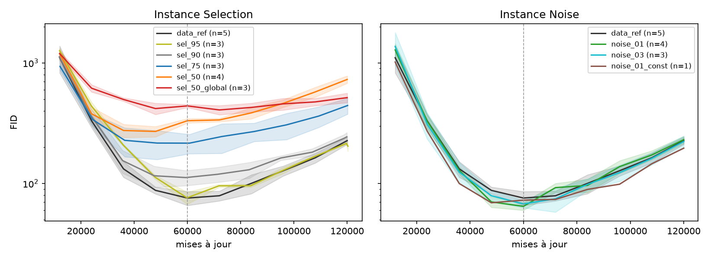
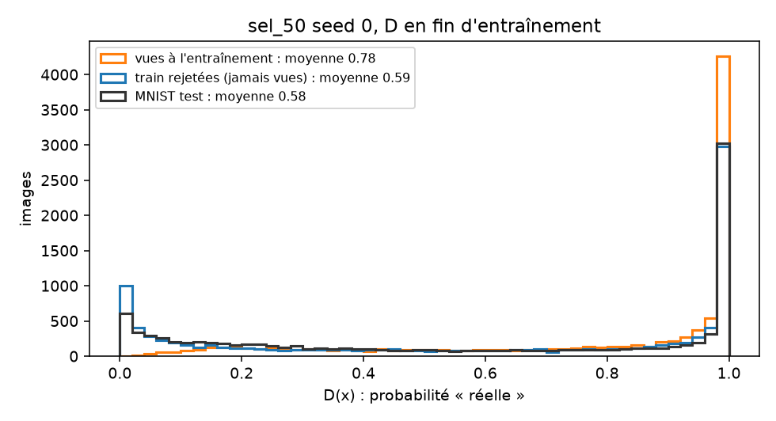

# Volet Données : Instance Selection et Instance Noise

**Responsable :** Nicodème. **Branche :** `nico/preprocessing`. **Code :** [`preprocessing.py`](preprocessing.py).

**Question (slide 76) :** si on change ce que voit le GAN, est-ce que la distribution qu'il apprend change, et en mieux ?

## Ce qu'il faut retenir

1. **Instance Selection** (ne garder que les images les plus typiques) **n'améliore jamais le modèle sur MNIST.**
   - **À 50 % ou 75 %,** elle le dégrade : les images sont plus propres, mais moins variées, et certains chiffres disparaissent (le 0 tombe à 0,4 % des images générées). Le FID passe de 76 à 331.
   - **À 95 %,** pour ne retirer que les images les plus atypiques, elle est neutre : FID 76 contre 76.
   - **À 90 %,** elle commence déjà à dégrader le modèle : FID 112.
   - **À ne pas garder.**
2. **Instance Noise** (bruiter les entrées de D) **ne change rien de mesurable.** Le FID passe de 76 à 65, un écart du même ordre que celui qu'on obtient en changeant de seed. Il n'empêche pas les échecs d'entraînement. **Facultatif, sans effet démontré.**
3. **Le vrai problème est ailleurs, côté entraînement :** 19 runs sur 52 échouent dès les premières époques, avec ou sans option. Le FID remonte aussi après 60 000 mises à jour. Ces deux points concernent le volet Entraînement.

## 1. Ce qui a été implémenté

Les deux options sont indépendantes et se règlent dans la section `data` du YAML. Avec `enabled: false`, ou sans la section, l'entraînement est exactement celui de la baseline.

```yaml
data:
  selection:
    enabled: true
    keep: 0.5             # fraction gardée
    per_class: true       # true : dans chaque chiffre ; false : sur tout le dataset
    space: classifier     # classifier (features) ou pixels (ACP à 50 dim)
  instance_noise:
    enabled: true
    sigma: 0.1            # écart-type initial, images dans [-1, 1]
    anneal_epochs: 100    # décroissance linéaire vers 0 ; 0 = sigma constant
```

**Instance Selection** (DeVries et al., 2020) :
- **Principe :** on ajuste une gaussienne sur les représentations de chaque chiffre, puis on garde les images dont la log-vraisemblance est la plus haute. Le GAN ne voit plus que ce sous-ensemble.
- **Évaluation :** elle reste faite sur le MNIST test complet.

**Instance Noise** (Sønderby et al., 2017) :
- **Principe :** on ajoute un bruit gaussien aux images réelles et générées avant de les donner à D, avec un écart-type qui décroît linéairement.
- **Mise en œuvre :** le code enveloppe D dans `InstanceNoise`, sans toucher à `model.py` ni à `D_train` / `G_train`.
- **Ce qui n'est pas bruité :** le générateur et les images enregistrées.

**Pourquoi ces deux méthodes :** elles agissent différemment sur ce que voit le GAN.
- **La sélection** retire de la masse aux données.
- **Le bruit** élargit les deux distributions pour qu'elles se recouvrent. C'est la raison théorique avancée par Arjovsky & Bottou (2017), et Mescheder et al. (2018) démontrent sa convergence locale sur le Dirac-GAN, avec σ > 0.

## 2. Les runs, un par un

**Quand chaque option agit :**
- **La sélection est calculée une seule fois, avant l'entraînement.** G et D ne voient alors que le sous-ensemble gardé, du début à la fin. L'évaluation, elle, se fait toujours contre le MNIST test complet.
- **Le bruit est ajouté à chaque passage dans D,** sur les vraies images comme sur les fausses. Avec décroissance, σ diminue linéairement pendant les 60 000 premières mises à jour, puis vaut 0 : **à 60 000 mises à jour, le point de comparaison, plus aucun bruit n'est actif**, sauf pour `noise_01_const`.

| Run | Ce que voient G et D | Sélection | Bruit sur les entrées de D | Époques | Seeds |
|---|---|---|---|---:|---:|
| `data_ref` | les 60 000 images | non | non | 200 | 8 |
| `sel_95` | 57 000 images | 95 % gardés, dans chaque chiffre, features du classifieur | non | 211 | 5 |
| `sel_90` | 54 000 images | 90 %, idem | non | 222 | 5 |
| `sel_75` | 45 000 images | 75 %, idem | non | 267 | 3 |
| `sel_50` | 30 000 images | 50 %, idem | non | 400 | 8 |
| `sel_50_global` | 30 000 images, classes déséquilibrées | 50 %, **sur tout le dataset**, features | non | 400 | 3 |
| `sel_50_pixels` | 30 000 images | 50 %, dans chaque chiffre, **ACP des pixels** | non | 400 | 3 |
| `noise_01` | les 60 000 images | non | σ = 0,1 → 0 entre 0 et 60 000 mises à jour | 200 | 8 |
| `noise_03` | les 60 000 images | non | σ = 0,3 → 0 entre 0 et 60 000 mises à jour | 200 | 3 |
| `noise_01_const` | les 60 000 images | non | σ = 0,1 **pendant tout l'entraînement** | 200 | 3 |
| `sel_50_noise_01` | 30 000 images | comme `sel_50` | comme `noise_01` | 400 | 3 |



*À gauche : la part des images d'entraînement gardée. À droite : σ selon le nombre de mises à jour. `noise_01` est caché sous `sel_50_noise_01`, qui a la même courbe. Pointillé : le point de comparaison.*

- **Même nombre de mises à jour pour tous :** 120 000. Moins il reste d'images, plus il faut d'époques.
- **Évaluation :** environ toutes les 12 000 mises à jour.

## 3. Protocole et tests

- **Point de comparaison :** 60 000 mises à jour, le creux du FID de la référence. Ce point est fixé une fois pour tous les runs, ce qui évite de choisir le meilleur moment de chacun sur le test. Les valeurs finales sont aussi données.
- **Une seule variable à la fois** par rapport à `data_ref`, sauf `sel_50_noise_01`, qui vérifie que les deux options se combinent.
- **Répétitions :** 52 runs sur Juliet (GPU), avec le commit `0bf18f5` inscrit dans chaque `config.yaml`.
- **Métriques :** FID, precision et recall k-NN (k = 3), calculés dans les features du classifieur partagé, sur 10 000 images, contre le MNIST test.
- **Runs ratés :** un run est dit raté si son recall final est inférieur à 0,01 (§ 8). Les moyennes les excluent, et leur nombre est indiqué.

| Test | Résultat |
|---|---|
| 7 tests unitaires ([`tests/test_preprocessing.py`](tests/test_preprocessing.py)) : score, taille et mélange des classes, planning de σ, aucun tirage aléatoire à σ = 0 | 7 réussis |
| Options désactivées contre `main` : 2 époques sur CPU, même seed | Poids de G identiques au bit près |
| Essai court de chaque option, avec reprise par `--resume` | Fonctionne |

## 4. Ce que fait la sélection, sur les vraies images



*Pour chaque chiffre : à gauche, les 10 images les plus typiques ; à droite, les 10 moins typiques.*

**Lecture :**
- **À gauche**, les images sont presque identiques : trait régulier, droit, centré.
- **À droite**, on trouve des styles réels mais minoritaires : 7 barré, 4 fermé, 1 avec empattement, 2 bouclé, traits épais ou très penchés.
- **Sur MNIST, les images rejetées sont donc surtout de la diversité, pas des erreurs.** C'est la différence de fond avec ImageNet, où le papier retire des photos ratées ou hors sujet.

Chaque sous-ensemble (10 000 images tirées au hasard) est ensuite comparé au MNIST test, comme s'il avait été généré. Cela donne **le mieux qu'un GAN parfait pourrait atteindre** en imitant ce sous-ensemble :

| Sous-ensemble | Images | FID | Precision | Recall | FID moyen par chiffre |
|---|---:|---:|---:|---:|---:|
| Tout le train | 60 000 | 2,9 | 0,864 | 0,892 | 9,2 |
| `sel_95` | 57 000 | 3,1 | 0,882 | 0,863 | 10,8 |
| `sel_90` | 54 000 | 5,0 | 0,893 | 0,842 | 14,3 |
| `sel_75` | 44 999 | 9,8 | 0,917 | 0,765 | 30,4 |
| `sel_50` | 30 000 | 25,3 | 0,942 | 0,630 | 67,1 |
| `sel_50_pixels` (ACP des pixels) | 30 000 | 21,8 | 0,933 | 0,640 | 64,7 |
| `sel_50_global` (sans séparer les chiffres) | 30 000 | **180,0** | 0,923 | 0,654 | |

**Lecture :**
- **La sélection rend les données plus « propres »** (precision de 0,86 à 0,94), mais **plus étroites** (recall de 0,89 à 0,63). Elle retire aussi la diversité qu'il faudrait reproduire.
- **À 95 %, le sous-ensemble est presque le train complet** (FID 3,1 contre 2,9). À 90 %, le recall a déjà perdu 0,05.
- **Sélectionner sans séparer les chiffres déséquilibre les classes :** il reste 1,4 % de 2 et 21,7 % de 1, d'où un FID de 180 avant même tout entraînement. C'est pour cela que le papier sélectionne par classe.
- **Les pixels donnent presque le même sous-ensemble que les features** (FID 21,8 contre 25,3). La sélection ne dépend donc pas beaucoup du classifieur.

## 5. Les scores des GAN


*Barre : moyenne des runs réussis. Points : chaque run. Losange blanc : le même score sur les vraies images que voit la variante (§ 4).*

| Variante | Runs ratés | FID à 60k ↓ | Precision à 60k ↑ | Recall à 60k ↑ | FID final | Precision finale | Recall final |
|---|---:|---:|---:|---:|---:|---:|---:|
| `data_ref` (aucune option) | 3 / 8 | **75,7 ± 10,0** | 0,753 | **0,718** | 226,6 | 0,851 | 0,745 |
| `sel_95` | 2 / 5 | **76,0 ± 8,8** | 0,775 | 0,680 | 203,9 | 0,859 | 0,725 |
| `sel_90` | 2 / 5 | 111,9 ± 16,0 | 0,793 | 0,646 | 243,7 | 0,872 | 0,688 |
| `sel_75` | 0 / 3 | 215,9 ± 39,4 | 0,837 | 0,563 | 443,2 | 0,893 | 0,581 |
| `sel_50` | 4 / 8 | 331,4 ± 13,3 | 0,843 | 0,382 | 729,0 | 0,932 | 0,362 |
| `sel_50_global` | 0 / 3 | 439,8 ± 12,7 | 0,801 | 0,356 | 515,0 | 0,881 | 0,455 |
| `sel_50_pixels` | 2 / 3 | 509,5 (1 run) | 0,882 | 0,331 | 836,2 | 0,931 | 0,318 |
| `noise_01` (σ = 0,1 → 0) | 4 / 8 | **64,6 ± 4,6** | 0,764 | **0,718** | 230,9 | 0,853 | 0,746 |
| `noise_03` (σ = 0,3 → 0) | 0 / 3 | 67,7 ± 4,8 | 0,763 | 0,719 | 222,9 | 0,848 | 0,772 |
| `noise_01_const` (σ = 0,1 fixe) | 2 / 3 | 72,7 (1 run) | 0,799 | 0,700 | 196,2 | 0,841 | 0,770 |
| `sel_50_noise_01` (les deux) | 0 / 3 | 336,4 ± 20,1 | **0,859** | 0,392 | 721,1 | 0,925 | 0,377 |

**Lecture :**
- **La sélection fait monter la precision** (0,75 → 0,84) et **chuter le recall** (0,72 → 0,38). Plus on sélectionne, plus l'effet est fort.
- **Une rétention élevée ne fait pas mieux :**
  - `sel_95` égale la référence (test de Welch, p = 0,97). Les 5 % retirés ne pesaient rien, ni en bien ni en mal.
  - `sel_90` est déjà moins bon (p = 0,07) : le recall baisse, comme pour les rétentions plus faibles.
  - Il n'y a donc pas de « bonne » rétention où le gain du papier apparaîtrait. Plus on retire d'images, plus le modèle se dégrade.
- **Le losange limite ce que le GAN peut atteindre.** Avec 50 % des images, même un GAN parfait aurait un recall de 0,63 et un FID de 25 : on s'impose un plafond plus bas avant même d'entraîner.
- **Le bruit ne déplace aucune barre** au-delà de l'écart entre seeds (test de Welch : p = 0,10 pour σ = 0,1, p = 0,23 pour σ = 0,3). L'écart s'annule à la fin.
- **Combiner les deux options** donne le comportement de la sélection seule : le bruit n'y ajoute rien.


*Chaque point est un run à 60 000 mises à jour. Les étoiles sont les vraies images sélectionnées.*

**Lecture :**
- **Deux nuages bien séparés.** En bas à droite, la référence et les variantes bruitées : diversité élevée, qualité moyenne. En haut à gauche, les variantes sélectionnées : qualité plus haute, diversité divisée par deux.
- **Le bruit ne crée pas de troisième nuage** : ses points se mélangent à ceux de la référence.
- **Aucun GAN n'atteint son étoile.** L'écart restant vient du modèle, pas des données.

## 6. Ce que ça donne en images



*Même vecteur z pour les 8 grilles : une même case correspond au même tirage aléatoire. Premier run réussi de chaque variante.*

**Lecture :**
- **`data_ref`** : les 10 chiffres sont présents, avec des styles variés. On voit quelques artefacts, comme une tache en ligne 5.
- **`sel_95`** : indiscernable de la référence, avec tous les chiffres et des styles variés.
- **`sel_90`** : tous les chiffres sont encore là, mais avec plus de 1 et des traits plus brouillés que sur les autres grilles.
- **`sel_75` et `sel_50`** : les traits sont plus nets et plus réguliers, mais les grilles sont dominées par des 1, des 7 et des 9. Le 0 est absent de la grille `sel_50`. C'est exactement « precision ↑, recall ↓ ».
- **`sel_50_global`** : les chiffres déjà rares dans son sous-ensemble (2, 5) se raréfient encore.
- **`noise_01` et `noise_03`** : visuellement indiscernables de la référence.


*Gris clair : les données d'entraînement, équilibrées dans les trois cas. Barres foncées : les images générées à 60k ; barres claires : en fin d'entraînement.*

**Lecture :**
- **`sel_90` garde à peu près le mélange de la référence** à 60k (8 % de 0, 3,5 % de 2), et dérive de la même façon ensuite. Le déséquilibre fort n'apparaît qu'à 50 %.
- **La sélection est faite chiffre par chiffre**, donc les données vues par `sel_50` restent équilibrées, à 10 % par chiffre.
- **Le GAN ne reproduit pourtant pas cet équilibre :** il génère 0,4 % de 0, 2,4 % de 2, et 16 à 17 % de 1, de 7 et de 9.
- **La raison :** notre générateur n'est pas conditionnel, et rien ne l'oblige à couvrir chaque chiffre. Dans le papier, le modèle reçoit la classe en entrée, et ce problème ne se pose pas.
- **Une piste (hypothèse) :** en retirant les images « frontières » entre chiffres, la sélection éloigne les chiffres les uns des autres. On compare la distance à l'image d'un autre chiffre la plus proche et la distance à l'image du même chiffre la plus proche. Leur rapport passe de 3,6 (tout le train) à 3,9 (95 %), 4,3 (90 %) et 5,2 (50 %) dans les features, et de 3,2 à 3,7 en pixels. Un générateur qui part d'un z continu atteint plus difficilement des modes isolés. La mesure montre que l'écart existe, pas qu'il est la cause : pour le savoir, il faudrait réinjecter les images frontières.

**Qualité à chiffre fixé.** Pour séparer la qualité des traits du mélange des chiffres, on calcule le FID de chaque chiffre généré contre le même chiffre réel. Le chiffre est celui prédit par le classifieur, sur 50 000 images du générateur final. On ne garde que les chiffres d'au moins 500 images, puis on fait la moyenne.

| Variante | FID moyen par chiffre | Plancher (vraies images) | Excès | Chiffres pris en compte |
|---|---:|---:|---:|---:|
| `data_ref` | 71,7 | 9,2 | 63 | 10 |
| `sel_95` | 64,5 | 10,8 | 54 | 9,7 |
| `sel_90` | 65,9 | 14,3 | 52 | 9,3 |
| `sel_75` | 79,6 | 30,4 | 49 | 8,3 |
| `sel_50` | 130,5 | 67,1 | 63 | 8 |
| `noise_01` | 64,1 | 9,2 | 55 | 9,8 |
| `noise_03` | 55,5 | 9,2 | 46 | 9,3 |

**Lecture :**
- **Le FID global de la sélection vient surtout du mélange des chiffres.** En fin d'entraînement, `sel_50` vaut 729 au global, mais 131 à chiffre fixé.
- **Au-dessus du plancher, `sel_50` et `data_ref` ont le même excès (63).** Le GAN n'apprend pas mieux la distribution réduite : il apprend seulement une cible plus étroite.
- **`noise_03` fait mieux que la référence à chiffre fixé** (55,5 contre 71,7 ; p = 0,04). Mais ce test ne porte que sur 3 runs et n'est pas corrigé pour le nombre de comparaisons : c'est un indice à revérifier, pas un résultat.
- **`sel_95` et `sel_90` aussi, un peu** (64,5 et 65,9 ; p = 0,05 et 0,19). Même prudence. Si l'effet est réel, il serait léger, et il ne compense pas la perte de diversité, puisque le FID global ne s'améliore pas.
- **Le nombre de chiffres pris en compte varie d'une ligne à l'autre** (`sel_50` exclut notamment le 0 et le 2) : les excès se comparent donc avec prudence.

## 7. Au fil de l'entraînement



*Moyenne ± écart-type des runs réussis. Pointillé : 60 000 mises à jour.*


**Lecture :**
- **Toutes les courbes sont en U.** Le meilleur FID se situe vers 48 000-72 000 mises à jour pour la référence, `sel_95` et `sel_90`. Il arrive plus tôt, vers 36 000-48 000, pour `sel_75` et `sel_50`.
- **À droite des courbes, les images ne se dégradent pas, elles se spécialisent.** À 120 000 mises à jour, les chiffres de `data_ref` sont aussi nets qu'à 60 000, et la precision passe même de 0,75 à 0,85. Mais les 1 envahissent la grille : ils passent de 16 % à 28 % des images, tandis que les 2 tombent de 4,8 % à 1,3 %. Le FID, sensible au mélange des chiffres, remonte de 76 à 227.
- **Le mélange final ressemble à celui d'une sélection globale à 50 %** : la corrélation passe de 0,78 à 60k à 0,95 à la fin, sur 10 classes. Le GAN semble concentrer sa masse sur les chiffres les plus denses, sans qu'on puisse en conclure la cause.
- **Le bruit ne retarde pas cette dérive** : à droite, les quatre courbes restent superposées jusqu'au bout.
- **Cela explique un écart constaté au début du projet :** la baseline à 50 époques (30 000 mises à jour) était encore en pleine descente.
- **Conséquence pratique** pour le volet Entraînement : arrêter vers 60 000 mises à jour, ou garder le checkpoint au meilleur FID sur une validation. 200 époques font pire que 100.

## 8. Les runs ratés


*À gauche : score moyen que D donne aux vraies images, pour les 8 seeds de `data_ref`. À droite : ce que produit un run raté.*

**Lecture :**
- **Ce n'est pas un mode collapse sur un chiffre.** Le générateur sort la même tache de bruit pour tous les z, et les 19 runs ratés ont tous cet aspect. Le classifieur les range ensuite le plus souvent dans « 8 » (11 des 15 premiers runs ratés) : c'est ce qui donnait l'illusion d'un effondrement « sur un chiffre ».
- **Tout se joue au tout début.** D reconnaît les vraies images avec certitude (D(x) = 1) dès l'époque 2 à 7. G ne reçoit alors plus de gradient utile, et le FID ne bouge plus. Les runs sains, eux, oscillent entre 0,7 et 0,85.
- **Ni la sélection ni le bruit n'y changent quoi que ce soit.** On compte 3 runs ratés sur 8 pour la référence, 4 sur 8 pour `sel_50` comme pour `noise_01`, et 2 sur 5 pour `sel_95` comme pour `sel_90` (test exact de Fisher, p = 1 à chaque fois). Le 0 sur 3 de `noise_03` et de `sel_75` ne prouve rien : avec un taux de base de 3/8, il arrive une fois sur quatre par hasard. Sur les 3 premières seeds, `sel_50` semblait rater plus souvent que la référence (2 sur 3 contre 0 sur 3) ; l'effet a disparu avec 8 seeds.
- **Pourquoi le bruit n'aide pas :** on pouvait en attendre mieux, puisqu'il est censé rendre la tâche de D plus difficile. Il est peut-être trop faible (σ = 0,1 pour des pixels dans [−1, 1]) pour empêcher D de gagner dès l'époque 2. Avec σ = 0,3, aucun des 3 runs n'a raté, mais 3 seeds ne suffisent pas pour conclure.
- **Conséquence pratique :** ce problème se règle côté entraînement. On peut surveiller D(x) et relancer le run s'il dépasse 0,98 avant l'époque 10, ou changer de perte, ce que teste le volet Entraînement.

## 9. Ce que D a appris



*D final de `sel_50` seed 0, 10 000 images de chaque groupe.*

**Lecture :**
- **D reconnaît les images qu'il a vues :** score moyen de 0,78, contre 0,58 sur le MNIST test.
- **Les images rejetées par la sélection, qu'il n'a jamais vues, reçoivent le même score que le test** (0,59). D a donc mémorisé ses images ; il n'a pas appris un critère de « typicité ».
- **Il rejette tout de même plus souvent les images atypiques :** près de 1 000 images rejetées tombent dans la tranche D(x) < 0,02, contre 600 pour le test.
- **La référence montre le même écart :** 0,68 à 0,76 sur les images vues, 0,51 à 0,60 sur le test. Cette mesure a été faite une seule fois, hors script.
- **Lien possible avec le § 7 :** ce sur-apprentissage de D expliquerait plausiblement la dérive, G étant poussé vers ce que D a mémorisé.

## 10. Différences avec les papiers

### Instance Selection

| | Papier | Nous | Conséquence probable |
|---|---|---|---|
| **Générateur** | SAGAN, BigGAN : **conditionnels** | MLP **sans condition** | Le mélange des classes n'est pas imposé : 0 et 2 peuvent disparaître (§ 6) |
| **Données** | ImageNet 64 à 256 px, 1 000 classes, images atypiques nombreuses | MNIST 28 px, 10 classes, déjà centré et propre | Moins de déchets à retirer : on enlève de la diversité utile (§ 4) |
| **Représentation** | Inception pré-entraîné sur ImageNet | Petit CNN entraîné sur MNIST | Même logique ; `sel_50_pixels` teste une représentation indépendante de la métrique |
| **Score** | Gaussienne, légèrement devant PPCA et KNN | Gaussienne, par chiffre | Identique |
| **Rétention** | 10 à 90 %, meilleur FID à 40 % en 64×64 | 95, 90, 75 et 50 % | Aucun taux ne fait mieux que la référence ; 95 % est neutre |
| **Capacité** | Réduite, ce que le papier présente comme un argument : moins de données à couvrir | G imposé (slides 74-75), D non modifié | Le gain n'est pas réinvesti dans un modèle mieux adapté |
| **Référence** | Distribution d'entraînement complète | MNIST test complet | Même principe : on mesure contre les données non filtrées |
| **Résultat** | FID de 17,2 à 9,1 (64×64), de 11,5 à 9,6 (128×128) ; recall de 0,66 à 0,50 | FID de 76 à 331 ; recall de 0,72 à 0,38 | Recall : même sens. FID : sens opposé |

### Instance Noise

| | Sønderby et al. (2017) | Nous |
|---|---|---|
| **Tâche** | Super-résolution, ImageNet | Génération sans condition, MNIST |
| **Motivation** | Supports disjoints ; entraînement instable sans le bruit | Même hypothèse testée |
| **Bruit** | Gaussien, linéairement de 0,1 à 0 | Identique pour `noise_01` ; on teste aussi σ = 0,3 et σ constant. Leur échelle d'images peut différer |
| **Portée** | Les auteurs ne l'ont pas testé en génération | C'est ce qu'on teste ici |

**Réponse à la question de départ.**
- **Oui, filtrer les images change la distribution apprise**, dans le sens prévu par le papier pour la precision et le recall.
- **Mais le gain du papier repose sur des hypothèses absentes ici :** un modèle conditionnel, des données qui contiennent de vrais déchets, et une capacité libérée puis réutilisée.
- **Sur MNIST, avec un MLP sans condition,** la queue de la distribution est de la diversité utile, et la retirer coûte plus qu'elle ne rapporte.

## 11. Recommandations pour le modèle final

| Option | Recommandation | Raison |
|---|---|---|
| Instance Selection | **Désactivée** | Neutre à 95 %, nuisible dès 90 % ; à 50 % : FID ×4, recall ÷2, chiffres manquants |
| Instance Noise | Désactivé, ou σ = 0,1 si l'on veut | Pas d'effet mesurable, pas de coût |
| Durée d'entraînement | ≈ 60 000 mises à jour, ou meilleur checkpoint sur validation | Le FID remonte ensuite |
| Runs ratés | Détecter D(x) > 0,98 tôt et relancer | Plus d'un run sur trois échoue, toutes options confondues |

**Rétention élevée (testée) :** à 95 %, on ne retire que les images les plus atypiques, et le modèle ne change pas. Sur MNIST, il n'y a presque pas de vraies anomalies à retirer.

**Ce qui pourrait faire marcher la sélection (non testé) :**
- **un générateur conditionnel**, mais l'architecture est imposée ;
- **une sélection par chiffre suivie d'un rééquilibrage** du mélange généré.

## Limites

- **Peu de seeds** pour certaines variantes : 3 runs réussis pour `sel_95` et `sel_90`, et un seul pour `sel_50_pixels` et `noise_01_const`. Les variantes à 3 seeds ne permettent pas de conclure sur les runs ratés.
- **Exclure les runs ratés** améliore les moyennes de toutes les variantes : les chiffres décrivent donc les runs qui ont réussi, pas toutes les tentatives.
- **La métrique et la sélection partagent le même classifieur.** Ce biais est signalé pour le papier aussi. `sel_50_pixels` donne un sous-ensemble équivalent sur les vraies images, mais ne lève pas le biais pour l'évaluation.
- **Le MNIST test sert de référence partout**, y compris pour choisir le point des 60 000 mises à jour. Nos runs utilisent les 60 000 images d'entraînement, car le split train / val de la branche `quentin/inference` n'est pas sur `main`. Avant le rapport final, il faudra refaire les chiffres retenus avec ce split.
- **Le FID n'est pas comparable** à celui de l'évaluation officielle, qui utilise un autre extracteur, ni à celui des runs MPS : avec une même seed, la baseline y donne 161 puis 188 selon le run.
- **Le FID par chiffre** utilise le chiffre prédit par le classifieur et le générateur final, et non celui à 60 000 mises à jour.
- **Les exemples d'images** viennent d'une seule seed par variante. Les tableaux, eux, portent sur tous les runs réussis.

## Reproduire

```bash
scripts/data_runs.sh                            # 9 variantes × seeds 0 à 2, sur Juliet
python figures/make_data_figures.py --real      # vraies images : sous-ensembles, extrêmes, écarts entre chiffres
python figures/make_data_figures.py             # bilan des runs : summary.csv, runs.csv
python figures/make_data_figures.py --per-class # FID par chiffre (long)
python figures/make_report_figures.py           # figures de ce rapport
python -m pytest tests/test_preprocessing.py
```

- **Seeds en plus :** 3 à 7 pour `data_ref`, `noise_01` et `sel_50`, puis 0 à 4 pour `sel_95` et `sel_90`. Chaque run se lance avec `python train.py --config configs/data/<variante>.yaml --seed <n>`.
- **Données nécessaires :** les runs dans `runs/`, avec leurs fichiers TensorBoard, et `D.pth` pour la figure du § 9.
- **Où sont les résultats :** les mesures brutes dans [`figures/data/`](figures/data/), les figures dans [`figures/report/`](figures/report/).

## Sources

- T. DeVries, M. Drozdzal, T. Taylor, [*Instance Selection for GANs*](https://arxiv.org/abs/2007.15255), NeurIPS 2020.
- C. Sønderby, J. Caballero, L. Theis, W. Shi, F. Huszár, [*Amortised MAP Inference for Image Super-resolution*](https://arxiv.org/abs/1610.04490), ICLR 2017.
- M. Arjovsky, L. Bottou, [*Towards Principled Methods for Training GANs*](https://arxiv.org/abs/1701.04862), ICLR 2017.
- L. Mescheder, A. Geiger, S. Nowozin, [*Which Training Methods for GANs do actually Converge?*](https://proceedings.mlr.press/v80/mescheder18a.html), ICML 2018.
