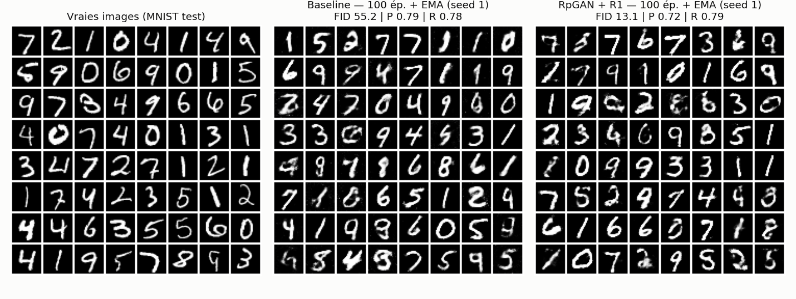
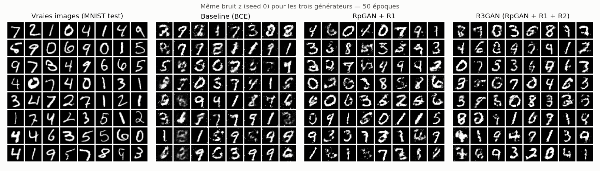
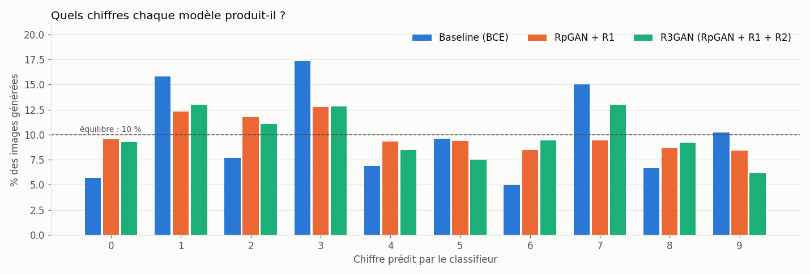
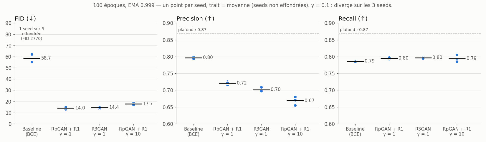

# Volet Entraînement : la perte R3GAN

> **En une phrase :** avec **le même générateur**, simplement entraîné avec la perte relativiste + R1 au lieu de la perte GAN d'origine, le FID passe de **58,7 à 14,0 ± 0,9** (3 seeds, 100 époques, EMA). L'entraînement devient **stable** (aucune seed effondrée, contre 1 sur 3 pour la baseline), et les dix chiffres sont générés **dans les bonnes proportions**.



*Même bruit z pour les deux générateurs. Seule la façon de les entraîner change. Résultats détaillés en [section 5](#5-campagne-finale--100-époques-ema-3-seeds).*

---

## 1. Le papier de référence

**Yiwen Huang, Aaron Gokaslan, Volodymyr Kuleshov, James Tompkin.**
*The GAN is dead; long live the GAN! A Modern GAN Baseline.* NeurIPS 2024.
[arXiv:2501.05441](https://arxiv.org/abs/2501.05441) · [NeurIPS](https://papers.nips.cc/paper_files/paper/2024/hash/4e2acb1e1c8e297d394ae29ed9535172-Abstract-Conference.html) · code : [brownvc/R3GAN](https://github.com/brownvc/R3GAN)

**L'idée.** Les GAN sont réputés instables. Leur entraînement s'appuie donc sur une accumulation d'astuces empiriques, et ils perdent souvent des « modes » (ici, des chiffres entiers). Les auteurs montrent que le problème vient surtout de **la fonction de perte**. Ils proposent une perte **relativiste régularisée**, appelée R3GAN :

- **RpGAN** (*relativistic pairing*) : le discriminateur ne juge plus chaque image séparément (« vraie ou fausse ? »). Il compare une vraie image et une fausse (« laquelle est la plus réaliste ? »). Les auteurs montrent que ce couplage évite les mauvais équilibres où le générateur oublie des modes.
- **R1 et R2** : deux pénalités sur les gradients du discriminateur, l'une autour des vraies images (R1), l'autre autour des fausses (R2). Avec les deux, le papier **démontre une convergence locale**, ce que la plupart des pertes relativistes n'ont pas.

Avec cette perte, ils retirent toutes les astuces habituelles et dépassent StyleGAN2 sur FFHQ, ImageNet, CIFAR-10 et **Stacked MNIST**, une variante à 1000 modes où ils les couvrent tous.

**Ce qu'on reprend, et ce qu'on ne reprend pas.** Le papier a deux parties : la perte, et une architecture modernisée (blocs ResNet, etc.). **On ne reprend que la perte**, puisque l'architecture du générateur est imposée (slides 74-75). C'est justement intéressant : on mesure ce que la perte seule apporte à un petit réseau entièrement connecté.

## 2. Ce qui a été implémenté

| | Baseline (code fourni) | R3GAN |
|---|---|---|
| Perte de D | `−log D(x) − log(1 − D(G(z)))` | `softplus(D(G(z)) − D(x))` + `γ/2 · (R1 + R2)` |
| Perte de G | `−log D(G(z))` | `softplus(D(x) − D(G(z)))` |
| R1 | — | `‖∇ₓ D(x)‖²` sur les vraies images |
| R2 | — | `‖∇ₓ D(G(z))‖²` sur les fausses images |

Dans la perte R3GAN, `D(·)` désigne le **score brut** du discriminateur, avant la sigmoïde. On utilise `γ = 1`.

**Dans le code :**
- [`utils.py`](utils.py) : `D_train_rpgan`, `G_train_rpgan`, `zero_centered_gp` (calcul de R1/R2) et `D_logits`. Ce dernier lit le score de D avant sa sigmoïde, ce qui évite de modifier `model.py`.
- [`train.py`](train.py) : lit une section `loss:` facultative dans le YAML. **Sans cette section, l'entraînement est exactement la baseline.**
- Les générateur et discriminateur de `model.py` **ne sont pas modifiés**.
- **EMA** (option `ema: {decay: 0.999}` du YAML, section 5) : `train.py` tient une moyenne mobile des poids du générateur. C'est elle qui est évaluée et sauvegardée dans `G.pth` ; le générateur brut va dans `G_raw.pth`. Sans cette option, rien ne change.

```yaml
loss:
  name: rpgan      # 'bce' = baseline
  r1_gamma: 1.0
  r2_gamma: 1.0
```

```bash
python train.py --config configs/train_r3gan.yaml
```

## 3. Protocole

On change **une seule chose à la fois** (slide 84). Tout le reste est identique à `configs/baseline.yaml` : 50 époques, batch 100, Adam (lr 2e-4, betas 0.9/0.999), seed 0. L'évaluation est celle du groupe (`evaluate.py`) : FID, precision et recall sur 10 000 images, comparées au MNIST test, avec le classifieur partagé `checkpoints/mnist_classifier.pth`.

| Config | Ce qui change |
|---|---|
| `baseline_rerun` | rien : la baseline du groupe, relancée sur la même machine en même temps que les autres runs |
| `train_rpgan` | perte relativiste **seule**, sans pénalité (10 époques suffisent pour voir ce qui se passe) |
| `train_rpgan_r1` | + R1 |
| `train_r3gan` | + R2 : R3GAN complet |
| `train_r3gan_adam` | + les betas d'Adam du papier (0, 0.99) |

## 4. Première série : 50 époques, seed 0

Cette première série a servi à repérer les configurations qui fonctionnent. La campagne finale (section 5) prolonge l'entraînement à 100 époques, ajoute l'EMA et répète chaque configuration sur 3 seeds.



| Run | FID ↓ | Precision ↑ | Recall ↑ | Chiffre le plus rare / le plus fréquent |
|---|---|---|---|---|
| *Plafond : MNIST train contre MNIST test* | *5,1* | *0,87* | *0,87* | *8,7 % / 11,4 %* |
| Baseline (BCE) | 188,0 | 0,64 | 0,32 | 5,0 % / 17,4 % |
| RpGAN seul | 2619 | 0,00 | 0,00 | diverge : 100 % de « 8 » |
| **RpGAN + R1** | **43,6** | **0,65** | **0,60** | **8,4 % / 12,7 %** |
| R3GAN (RpGAN + R1 + R2) | 48,9 | 0,65 | 0,58 | 6,2 % / 13,0 % |
| R3GAN + Adam (0, 0.99) | 1540 | 0,46 | 0,00 | effondrement |

Tous les chiffres sont dans [`results.csv`](results.csv) et les logs complets dans [`logs/`](logs/).

### 4.1 Le gain : FID ÷ 4, recall × 2, sans perte de precision


- **R3GAN atteint dès l'époque 10 le niveau final de la baseline :** FID 170 contre 188 pour la baseline à l'époque 50.
- **La baseline ne couvre presque rien pendant 30 époques :** son recall vaut 0 jusqu'à l'époque 30. Elle produit des images que le classifieur reconnaît (precision 0,66), mais toujours de la même famille. Avec RpGAN, le recall monte dès le début.
- **Pas de compromis à 50 époques :** la precision reste la même (0,64 → 0,65) alors que le recall double. À 100 époques avec EMA, la baseline rattrape ce recall ; la différence se joue alors ailleurs (section 5).

### 4.2 Une meilleure couverture des dix chiffres



La baseline sur-produit les **1, 3 et 7** (15 à 17 %) et néglige les **0 et 6** (5 à 6 %). Avec la perte relativiste, la répartition se rapproche des 10 % attendus pour chaque chiffre. C'est l'effet décrit dans le papier : la perte relativiste limite l'oubli de modes.

### 4.3 Ce qui échoue, et pourquoi c'est instructif


- **RpGAN sans pénalité diverge dès la première époque.** Le discriminateur gagne complètement : son score brut explose et D(x) = D(G(z)) = 1,00 après la sigmoïde. Le générateur ne reçoit plus de gradient utile et sort la même image de bruit pour tous les z. **R1 est donc indispensable**, conformément à l'analyse du papier : sans régularisation, la perte relativiste n'a pas de garantie de convergence.
- **Les betas d'Adam du papier (0, 0.99) font s'effondrer l'entraînement** sur quelques formes (« 1 », « 4 », traits). Ces réglages vont avec l'architecture et le calendrier d'entraînement du papier, pas avec notre petit réseau. On garde donc les betas de la baseline.

### 4.4 Coût

R1 et R2 demandent un second calcul de gradient pour le discriminateur. Sur un Mac M3, la médiane est de **44 s/époque pour la baseline, 46 s avec R1 et 48 s avec R1 + R2**, soit environ +5 à 10 %. Ces mesures ont été faites avec les runs en parallèle, donc elles restent approximatives. La génération n'est pas affectée : seul l'entraînement change.

## 5. Campagne finale : 100 époques, EMA, 3 seeds

**Ce qui change par rapport à la section 4 :**
- **100 époques au lieu de 50** : à 50 époques, les FID baissaient encore.
- **EMA des poids du générateur** (decay 0,999) : on rend une moyenne mobile des poids plutôt que leur dernière valeur, ce qui lisse le bruit de l'entraînement. Elle est appliquée à **toutes** les configurations, baseline comprise, pour que la comparaison reste juste.
- **3 seeds par configuration**, pour distinguer un vrai gain du hasard.

Configs : [`configs/sweep/`](configs/sweep/) ; lancement : [`scripts/sweep_training.py`](scripts/sweep_training.py).

| Configuration | FID ↓ (moyenne ± écart-type) | Precision ↑ | Recall ↑ | Seeds stables |
|---|---|---|---|---|
| *Plafond : MNIST train contre MNIST test* | *5,1* | *0,87* | *0,87* | — |
| Baseline (BCE) | 58,7 ± 4,8 | **0,80** | 0,79 | **2 / 3** (seed 2 effondrée : FID 2770) |
| **RpGAN + R1, γ = 1** | **14,0 ± 0,9** | 0,72 | 0,80 | 3 / 3 |
| R3GAN (RpGAN + R1 + R2), γ = 1 | 14,4 ± 0,9 | 0,70 | 0,80 | 3 / 3 |
| RpGAN + R1, γ = 10 | 17,7 ± 0,9 | 0,67 | 0,79 | 3 / 3 |
| RpGAN + R1, γ = 0,1 | diverge | — | — | 0 / 3 (arrêtés à l'époque 27) |



### 5.1 Le FID est divisé par 4, et l'entraînement devient fiable

- **FID 14,0 ± 0,9 contre 58,7 ± 4,8.** L'écart est bien plus grand que la variabilité entre seeds : ce n'est pas du hasard. Le meilleur modèle (RpGAN + R1, seed 1) atteint **13,1**.
- **La baseline n'est pas fiable :** une seed sur trois s'effondre complètement (100 % de « 8 »). Avec la perte relativiste + R1, les 3 seeds convergent toutes, et à des valeurs très proches.
- **EMA et entraînement plus long aident tout le monde :** la baseline passe de 188 à 59 et RpGAN + R1 de 43,6 à 14,0. Le classement reste le même.

### 5.2 Pourquoi le FID s'améliore alors que la precision baisse ?

À 100 époques, **le recall est le même partout (0,79-0,80)**, et la baseline a même **la meilleure precision (0,80 contre 0,72)**. Pourtant, son FID est 4 fois plus élevé. L'explication est dans la répartition des chiffres générés :

| | Chiffre le plus rare | Chiffre le plus fréquent | Écart-type des proportions |
|---|---|---|---|
| Baseline (seeds 0 et 1) | 4,2 % (« 2 ») | 14,7-15,9 % (« 1 », « 7 ») | 3,0-3,4 points |
| RpGAN + R1 (3 seeds) | 7,7-8,0 % | 12,0-12,6 % | 1,2-1,6 point |

La baseline **couvre** tous les chiffres, mais **dans de mauvaises proportions** : presque 4 fois plus de « 1 » que de « 2 ». Or la precision et le recall par plus proches voisins ne mesurent que le **support** : ils regardent si les images tombent dans la zone des vraies données, pas avec quelle fréquence. Le FID, lui, compare les deux distributions, proportions comprises. C'est exactement la limite des precision/recall « par support » présentée en cours (slides 17-30), et la raison pour laquelle le cours introduit la courbe PR, qui dépend des densités.

**Ce que la perte relativiste apporte ici :** comparer chaque fausse image à une vraie image tirée au hasard pousse le générateur à reproduire **la répartition** des données, pas seulement leur support. C'est l'effet anti-oubli de modes décrit par Huang et al.

**Le prix à payer :** un peu de precision (0,80 → 0,72). Quelques images de RpGAN + R1 sont moins nettes (artefacts granuleux). C'est précisément ce que le rejet par discriminateur (DRS/OBRS, volet Inférence) peut corriger.

### 5.3 R2 et le choix de γ

- **R2 n'apporte rien de mesurable :** 14,4 ± 0,9 avec R2 contre 14,0 ± 0,9 sans. La différence est inférieure à la variabilité entre seeds, et la precision est même un peu plus basse avec R2 (0,70 contre 0,72). Sur ce petit réseau, **R1 seul suffit** à stabiliser l'entraînement. Le papier justifie R2 par une garantie théorique de convergence, qu'on n'observe pas comme gain pratique ici.
- **γ = 1 est le bon réglage :**
  - **γ = 0,1** : pénalité trop faible. Les 3 seeds divergent comme sans pénalité (FID supérieur à 2000 à l'époque 27).
  - **γ = 10** : pénalité trop forte. Le discriminateur devient trop « mou », le FID remonte à 17,7 et la precision baisse (0,67).

## 6. Limites et suite

- **La baseline à 50 époques n'avait pas convergé** (section 4). La campagne à 100 époques corrige ce point, mais les deux configurations progressaient encore légèrement à l'époque 100.
- **Les métriques sont relatives** : elles reposent sur le classifieur du groupe et ne sont pas comparables en valeur absolue à l'évaluation officielle.
- **Deux baselines différentes coexistent dans le repo.** `checkpoints/G.pth` donne FID 104 / P 0,80 / R 0,75, alors que `runs/baseline/G.pth` et notre `baseline_rerun` donnent 162 à 188. Il faut décider laquelle sert de référence dans le rapport. R3GAN reste nettement meilleur que les deux.
- **Combinaison avec l'inférence :** le rejet (OBRS, volet `quentin/inference`) devrait regagner la precision perdue. **Attention :** OBRS suppose que le discriminateur estime le rapport de densités `p/p̂` (c'est le cas avec la perte BCE). Le score d'un discriminateur relativiste compare deux images et ne donne pas ce rapport directement. Il faudra donc réentraîner brièvement un discriminateur BCE sur le générateur figé avant de l'utiliser pour le rejet.
- **Modèle à rendre :** le meilleur générateur est `runs/ema100_rpgan_r1_s1/G.pth` (FID 13,1). Il n'est pas encore copié dans `checkpoints/G.pth` : c'est une décision de groupe.

---

*Les figures se régénèrent avec `DATA=<chemin MNIST> PYTHONPATH=. python figures/make_training_figures.py` (section 4) et `figures/make_campaign_figures.py` (section 5).*
