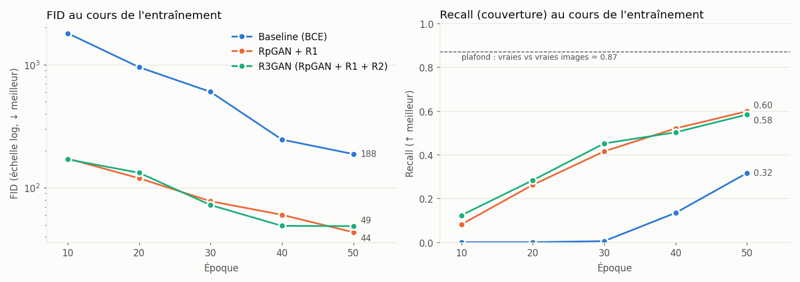
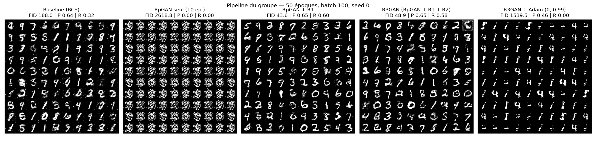

# Volet Entraînement : la perte R3GAN

> **En une phrase :** avec **le même générateur**, simplement entraîné avec la perte de R3GAN au lieu de la perte GAN d'origine, le FID passe de **188 à 44**, le recall de **0,32 à 0,60**, à precision égale (0,64 → 0,65).


*Les trois générateurs reçoivent exactement le même bruit z. Seule la façon de les entraîner change. La baseline produit des chiffres flous et tachés ; avec R3GAN, les traits sont nets et les dix chiffres sont représentés.*

---

## 1. Le papier de référence

**Yiwen Huang, Aaron Gokaslan, Volodymyr Kuleshov, James Tompkin.**
*The GAN is dead; long live the GAN! A Modern GAN Baseline.* NeurIPS 2024.
[arXiv:2501.05441](https://arxiv.org/abs/2501.05441) · [NeurIPS](https://papers.nips.cc/paper_files/paper/2024/hash/4e2acb1e1c8e297d394ae29ed9535172-Abstract-Conference.html) · code : [brownvc/R3GAN](https://github.com/brownvc/R3GAN)

**L'idée.** Les GAN sont réputés instables. Leur entraînement s'appuie donc sur une accumulation d'astuces empiriques, et ils perdent souvent des « modes » (ici, des chiffres entiers). Les auteurs montrent que le problème vient surtout de **la fonction de perte**. Ils proposent une perte **relativiste régularisée**, appelée R3GAN :

- **RpGAN** (*relativistic pairing*) : le discriminateur ne juge plus chaque image séparément (« vraie ou fausse ? »). Il compare une vraie image et une fausse (« laquelle est la plus réaliste ? »). Les auteurs montrent que ce couplage évite les mauvais équilibres où le générateur oublie des modes.
- **R1 et R2** : deux pénalités sur les gradients du discriminateur, l'une autour des vraies images (R1), l'autre autour des fausses (R2). Avec les deux, le papier **démontre une convergence locale**, ce que la plupart des pertes relativistes n'ont pas.

Avec cette perte, ils retirent toutes les astuces habituelles et dépassent StyleGAN2 sur FFHQ, ImageNet, CIFAR-10 et **Stacked MNIST**, une variante à 1000 modes où ils les couvrent tous.

**Ce qu'on reprend, et ce qu'on ne reprend pas.** Le papier a deux parties : la perte, et une architecture modernisée (blocs ResNet, etc.). **On ne reprend que la perte**, puisque l'architecture du générateur est imposée (slides 74-75). C'est justement intéressant : on mesure ce que la perte seule apporte à un petit réseau entièrement connecté.

## 2. Ce qui a été implémenté

| | Baseline (code fourni) | R3GAN |
|---|---|---|
| Perte de D | `−log D(x) − log(1 − D(G(z)))` | `softplus(D(G(z)) − D(x))` + `γ/2 · (R1 + R2)` |
| Perte de G | `−log D(G(z))` | `softplus(D(x) − D(G(z)))` |
| R1 | — | `‖∇ₓ D(x)‖²` sur les vraies images |
| R2 | — | `‖∇ₓ D(G(z))‖²` sur les fausses images |

Dans la perte R3GAN, `D(·)` désigne le **score brut** du discriminateur, avant la sigmoïde. On utilise `γ = 1`.

**Dans le code :**
- [`utils.py`](utils.py) : `D_train_rpgan`, `G_train_rpgan`, `zero_centered_gp` (calcul de R1/R2) et `D_logits`. Ce dernier lit le score de D avant sa sigmoïde, ce qui évite de modifier `model.py`.
- [`train.py`](train.py) : lit une section `loss:` facultative dans le YAML. **Sans cette section, l'entraînement est exactement la baseline.**
- Les générateur et discriminateur de `model.py` **ne sont pas modifiés**.

```yaml
loss:
  name: rpgan      # 'bce' = baseline
  r1_gamma: 1.0
  r2_gamma: 1.0
```

```bash
python train.py --config configs/train_r3gan.yaml
```

## 3. Protocole

On change **une seule chose à la fois** (slide 84). Tout le reste est identique à `configs/baseline.yaml` : 50 époques, batch 100, Adam (lr 2e-4, betas 0.9/0.999), seed 0. L'évaluation est celle du groupe (`evaluate.py`) : FID, precision et recall sur 10 000 images, comparées au MNIST test, avec le classifieur partagé `checkpoints/mnist_classifier.pth`.

| Config | Ce qui change |
|---|---|
| `baseline_rerun` | rien : la baseline du groupe, relancée sur la même machine en même temps que les autres runs |
| `train_rpgan` | perte relativiste **seule**, sans pénalité (10 époques suffisent pour voir ce qui se passe) |
| `train_rpgan_r1` | + R1 |
| `train_r3gan` | + R2 : R3GAN complet |
| `train_r3gan_adam` | + les betas d'Adam du papier (0, 0.99) |

## 4. Résultats

| Run | FID ↓ | Precision ↑ | Recall ↑ | Chiffre le plus rare / le plus fréquent |
|---|---|---|---|---|
| *Plafond : MNIST train contre MNIST test* | *5,1* | *0,87* | *0,87* | *8,7 % / 11,4 %* |
| Baseline (BCE) | 188,0 | 0,64 | 0,32 | 5,0 % / 17,4 % |
| RpGAN seul | 2619 | 0,00 | 0,00 | diverge : 100 % de « 8 » |
| **RpGAN + R1** | **43,6** | **0,65** | **0,60** | **8,4 % / 12,7 %** |
| R3GAN (RpGAN + R1 + R2) | 48,9 | 0,65 | 0,58 | 6,2 % / 13,0 % |
| R3GAN + Adam (0, 0.99) | 1540 | 0,46 | 0,00 | effondrement |

Tous les chiffres sont dans [`results.csv`](results.csv) et les logs complets dans [`logs/`](logs/).

### 4.1 Le gain : FID ÷ 4, recall × 2, sans perte de precision



- **R3GAN atteint dès l'époque 10 le niveau final de la baseline :** FID 170 contre 188 pour la baseline à l'époque 50.
- **La baseline ne couvre presque rien pendant 30 époques :** son recall vaut 0 jusqu'à l'époque 30. Elle produit des images que le classifieur reconnaît (precision 0,66), mais toujours de la même famille. Avec RpGAN, le recall monte dès le début.
- **Pas de compromis ici :** la precision reste la même (0,64 → 0,65) alors que le recall double. On n'échange donc pas de la qualité contre de la diversité : le générateur exploite mieux sa capacité.

### 4.2 Une meilleure couverture des dix chiffres


La baseline sur-produit les **1, 3 et 7** (15 à 17 %) et néglige les **0 et 6** (5 à 6 %). Avec la perte relativiste, la répartition se rapproche des 10 % attendus pour chaque chiffre. C'est l'effet décrit dans le papier : la perte relativiste limite l'oubli de modes.

### 4.3 Ce qui échoue, et pourquoi c'est instructif



- **RpGAN sans pénalité diverge dès la première époque.** Le discriminateur gagne complètement : son score brut explose et D(x) = D(G(z)) = 1,00 après la sigmoïde. Le générateur ne reçoit plus de gradient utile et sort la même image de bruit pour tous les z. **R1 est donc indispensable**, conformément à l'analyse du papier : sans régularisation, la perte relativiste n'a pas de garantie de convergence.
- **Les betas d'Adam du papier (0, 0.99) font s'effondrer l'entraînement** sur quelques formes (« 1 », « 4 », traits). Ces réglages vont avec l'architecture et le calendrier d'entraînement du papier, pas avec notre petit réseau. On garde donc les betas de la baseline.

### 4.4 Coût

R1 et R2 demandent un second calcul de gradient pour le discriminateur. Sur un Mac M3, la médiane est de **44 s/époque pour la baseline, 46 s avec R1 et 48 s avec R1 + R2**, soit environ +5 à 10 %. Ces mesures ont été faites avec les runs en parallèle, donc elles restent approximatives. La génération n'est pas affectée : seul l'entraînement change.

## 5. Limites et suite

- **Une seule seed.** R1 seul (43,6) et R1 + R2 (48,9) sont trop proches pour être départagés. Dans une première série de runs (batch 64, autre évaluation), l'ordre était inversé (R3GAN 39 contre RpGAN + R1 54). L'écart entre les deux est donc probablement dans le bruit. **Le gain par rapport à la baseline, lui, est net et reproduit dans les deux séries.** À faire : 2 à 3 seeds par configuration.
- **La baseline n'a pas convergé à 50 époques** : son FID baisse encore. À faire : comparer aussi à un budget plus long, pour séparer « converge plus vite » de « converge mieux ».
- **γ = 1 n'a pas été réglé.** À faire : balayage γ ∈ {0,1 ; 1 ; 10}.
- **Les métriques sont relatives** : elles reposent sur le classifieur du groupe et ne sont pas comparables en valeur absolue à l'évaluation officielle.
- **Deux baselines différentes coexistent dans le repo.** `checkpoints/G.pth` donne FID 104 / P 0,80 / R 0,75, alors que `runs/baseline/G.pth` et notre `baseline_rerun` donnent 162 à 188. Il faut décider laquelle sert de référence dans le rapport. R3GAN reste nettement meilleur que les deux.
- **Combinaison avec l'inférence :** le discriminateur de R3GAN, mieux régularisé, est un bon candidat pour l'OBRS du volet Inférence (`quentin/inference`), qui pourrait regagner de la precision.

---

*Les figures se régénèrent avec `DATA=<chemin MNIST> PYTHONPATH=. python figures/make_training_figures.py`.*
